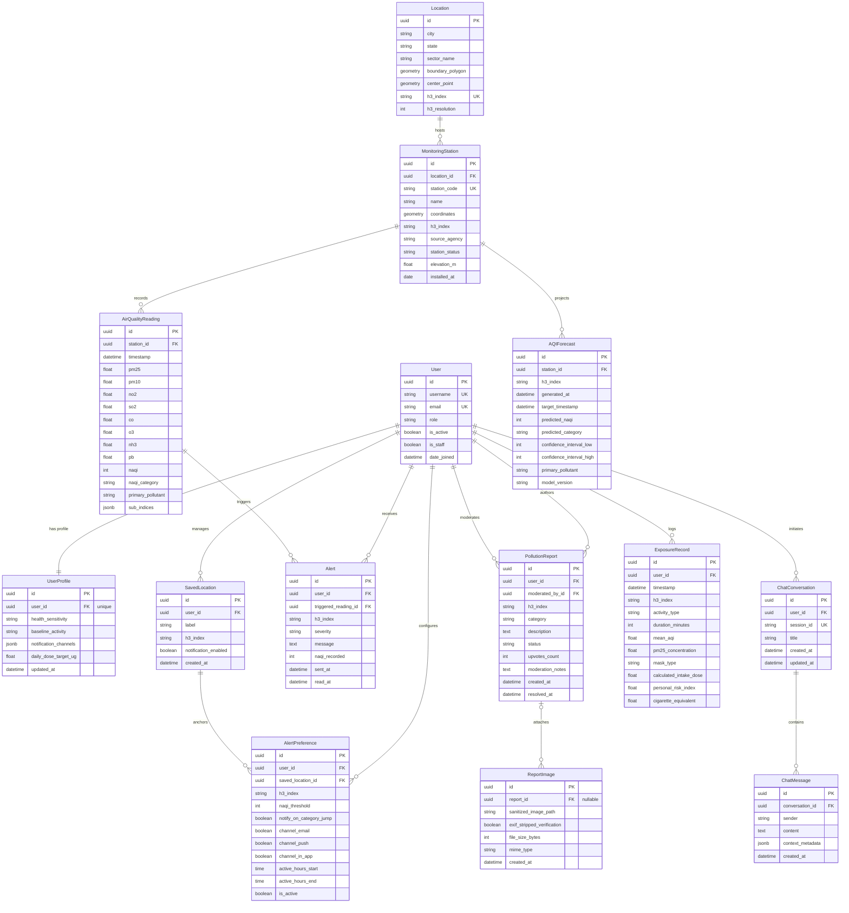

# BreatheWise: Database Schema Specification
## Complete Relational & Spatial Schema for PostgreSQL 16 + PostGIS 3.4 (All 14 Specified Models)

**Document Identifier**: `DATABASE_SCHEMA.md`  
**System Name**: BreatheWise Urban Air Quality Assistance Platform  
**Target Database Engine**: PostgreSQL 16.4 with PostGIS 3.4 Spatial Extension  
**Coordinate Reference System**: WGS 84 (EPSG:4326 / SRID 4326)  
**Spatial Partitioning**: Uber H3 Discrete Global Grid (Resolution 7 / 8)  
**Document Version**: 2.0.0  
**Status**: Authoritative Database Baseline  

---

## Table of Contents
1. [Database Architecture & Spatial Extensions](#1-database-architecture--spatial-extensions)
   - 1.1 Technology Stack & PostGIS Configuration
   - 1.2 Coordinate Reference Systems & Spatial Indexing
   - 1.3 Privacy-by-Design Spatial Hashing Policy
2. [Comprehensive Entity Relationship (ER) Diagram](#2-comprehensive-entity-relationship-er-diagram)
3. [Exhaustive Model Specifications (All 14 Models)](#3-exhaustive-model-specifications-all-14-models)
   - 3.1 Model 1: `User` (`accounts_user`)
   - 3.2 Model 2: `UserProfile` (`accounts_userprofile`)
   - 3.3 Model 3: `Location` (`locations_location`)
   - 3.4 Model 4: `MonitoringStation` (`locations_monitoringstation`)
   - 3.5 Model 5: `AirQualityReading` (`air_quality_airqualityreading`)
   - 3.6 Model 6: `AQIForecast` (`forecasting_aqiforecast`)
   - 3.7 Model 7: `AlertPreference` (`alerts_alertpreference`)
   - 3.8 Model 8: `Alert` (`alerts_alert`)
   - 3.9 Model 9: `PollutionReport` (`reports_pollutionreport`)
   - 3.10 Model 10: `ReportImage` (`reports_reportimage`)
   - 3.11 Model 11: `ChatConversation` (`assistant_chatconversation`)
   - 3.12 Model 12: `ChatMessage` (`assistant_chatmessage`)
   - 3.13 Model 13: `ExposureRecord` (`exposure_exposurerecord`)
   - 3.14 Model 14: `SavedLocation` (`locations_savedlocation`)
4. [PostgreSQL 16 + PostGIS DDL Reference](#4-postgresql-16--postgis-ddl-reference)
5. [Database Indexing, Migration & Optimization Strategy](#5-database-indexing-migration--optimization-strategy)
   - 5.1 GIST Spatial Indexing vs. B-Tree Indexes
   - 5.2 Time-Series Range Partitioning for Readings & Forecasts
   - 5.3 Vacuuming & PostGIS Statistics Tuning

---

## 1. Database Architecture & Spatial Extensions

### 1.1 Technology Stack & PostGIS Configuration
BreatheWise utilizes **PostgreSQL 16** coupled with the **PostGIS 3.4** spatial extension running in an optimized containerized instance. On container startup, the database cluster executes:
```sql
CREATE EXTENSION IF NOT EXISTS postgis;
CREATE EXTENSION IF NOT EXISTS "uuid-ossp";
```
All primary keys across user-facing and telemetry models are generated as version 4 Universally Unique Identifiers (UUIDv4) to guarantee zero primary key collision during distributed ingestion and cross-database migrations.

### 1.2 Coordinate Reference Systems & Spatial Indexing
- **Spatial Reference System**: Standard GPS World Geodetic System 1984 (`EPSG:4326`, SRID 4326) with coordinate storage ordered as `(longitude, latitude)` in compliance with OGC standards.
- **Geometry Types**:
  - `PointField(srid=4326)`: Monitoring station locations, sector geographic centroids.
  - `PolygonField(srid=4326)`: Sector boundary envelopes and urban municipal demarcations.
- **Spatial Indexing**: All PostGIS geometry columns utilize Generalized Search Tree (`GIST`) indexing (`USING GIST(coordinates)`), providing logarithmic time complexity $O(\log N)$ for bounding-box (`&&`), distance (`ST_DWithin`), and containment (`ST_Contains`) evaluations.

### 1.3 Privacy-by-Design Spatial Hashing Policy
In strict compliance with India's **Digital Personal Data Protection Act (DPDP Act 2023)**:
- User-generated models (`SavedLocation`, `PollutionReport`, `ExposureRecord`, `AlertPreference`) **do not contain PostGIS point or geometry columns**.
- Locations are persisted exclusively as 15-character string identifiers (`h3_index` of type `VARCHAR(20)`), representing Uber H3 Resolution 8 hexagonal cells ($\sim 0.737 \text{ km}^2$, edge $\approx 461 \text{ meters}$).
- B-tree indexing on `h3_index` provides high-speed equality joins with pre-computed spatial grid polygons.

---

## 2. Comprehensive Entity Relationship (ER) Diagram



---

## 3. Exhaustive Model Specifications (All 14 Models)

### 3.1 Model 1: `User`
- **Application Mapping**: `apps.accounts`
- **Database Table Name**: `accounts_user`
- **Model Base Class**: `django.contrib.auth.models.AbstractUser`
- **Description**: Custom authentication entity replacing Django's default user model. Serves as the identity root, utilizing email as the primary login credential with granular Role-Based Access Control (RBAC).

| Field Name | Django Field Type | Nullable | Blank | Constraints & Options | Description |
|---|---|---|---|---|---|
| `id` | `UUIDField` | `False` | `False` | `primary_key=True`, `default=uuid.uuid4`, `editable=False` | Globally unique immutable identifier |
| `username` | `CharField(150)` | `False` | `False` | `unique=True`, `db_index=True` | Unique username slug for system identification |
| `email` | `EmailField(254)` | `False` | `False` | `unique=True`, `db_index=True` | Normalized primary user email credential |
| `password` | `CharField(128)` | `False` | `False` | Standard Django PBKDF2 / Argon2 hashing | Cryptographic password hash |
| `first_name` | `CharField(150)` | `False` | `True` | Max length 150 | Given user first name |
| `last_name` | `CharField(150)` | `False` | `True` | Max length 150 | Given user surname |
| `role` | `CharField(30)` | `False` | `False` | `choices=[('citizen', 'General Citizen'), ('sensitive_individual', 'Sensitive Health Individual'), ('outdoor_enthusiast', 'Outdoor Enthusiast / Commuter'), ('official', 'Municipal Environmental Officer'), ('admin', 'System Administrator')]`, `default='citizen'` | RBAC authorization role governing access |
| `is_active` | `BooleanField` | `False` | `False` | `default=True` | Account status flag |
| `is_staff` | `BooleanField` | `False` | `False` | `default=False` | Admin site access permission |
| `is_superuser` | `BooleanField` | `False` | `False` | `default=False` | Superuser full override permission |
| `date_joined` | `DateTimeField` | `False` | `False` | `auto_now_add=True` | Account creation timestamp (UTC) |
| `last_login` | `DateTimeField` | `True` | `True` | `null=True`, `blank=True` | Timestamp of most recent authentication |

- **Indexes**:
  - Unique B-Tree Index: `accounts_user_email_uniq` ON (`email`)
  - Unique B-Tree Index: `accounts_user_username_uniq` ON (`username`)
  - B-Tree Index: `accounts_user_role_idx` ON (`role`)

---

### 3.2 Model 2: `UserProfile`
- **Application Mapping**: `apps.accounts`
- **Database Table Name**: `accounts_userprofile`
- **Description**: Extends `User` with biometric, health sensitivity, baseline physical activity parameters, and dispatch settings.

| Field Name | Django Field Type | Nullable | Blank | Constraints & Options | Description |
|---|---|---|---|---|---|
| `id` | `UUIDField` | `False` | `False` | `primary_key=True`, `default=uuid.uuid4`, `editable=False` | Profile identifier |
| `user` | `OneToOneField` | `False` | `False` | `to=User`, `on_delete=CASCADE`, `related_name='profile'` | Direct foreign key mapping to user identity |
| `health_sensitivity`| `CharField(30)` | `False` | `False` | `choices=[('normal', 'Normal'), ('asthma', 'Asthma'), ('copd', 'COPD'), ('cardiovascular', 'Cardiovascular Disease'), ('elderly', 'Elderly (65+)'), ('child', 'Child (<12)'), ('pregnant', 'Pregnant Individual')]`, `default='normal'` | Vulnerability factor $\gamma_{\text{sensitivity}}$ |
| `baseline_activity` | `CharField(20)` | `False` | `False` | `choices=[('sedentary', 'Sedentary'), ('moderate', 'Moderate'), ('active', 'Active'), ('athlete', 'Athlete')]`, `default='moderate'` | Daily baseline physical activity level |
| `notification_channels` | `JSONField` | `False` | `False` | `default=dict` | Notification dispatch toggles (`{"email": true, "push": true, "in_app": true}`) |
| `daily_dose_target_ug` | `FloatField` | `False` | `False` | `default=180.0` | Maximum recommended daily PM2.5 intake target ($\mu g$) |
| `created_at` | `DateTimeField` | `False` | `False` | `auto_now_add=True` | Profile creation timestamp |
| `updated_at` | `DateTimeField` | `False` | `False` | `auto_now=True` | Last profile update timestamp |

- **Indexes**:
  - Unique B-Tree Index: `accounts_userprofile_user_id_uniq` ON (`user_id`)

---

### 3.3 Model 3: `Location`
- **Application Mapping**: `apps.locations`
- **Database Table Name**: `locations_location`
- **Description**: Spatial boundary model representing Chandigarh sectors, institutional campuses, and municipal demarcations indexed via PostGIS geometries and Uber H3.

| Field Name | Django Field Type | Nullable | Blank | Constraints & Options | Description |
|---|---|---|---|---|---|
| `id` | `UUIDField` | `False` | `False` | `primary_key=True`, `default=uuid.uuid4`, `editable=False` | Location record UUID |
| `city` | `CharField(100)` | `False` | `False` | `default='Chandigarh'` | Urban municipal agglomeration name |
| `state` | `CharField(100)` | `False` | `False` | `default='Chandigarh UT'` | State / Union Territory name |
| `sector_name` | `CharField(100)` | `False` | `False` | e.g. `'Sector 17'`, `'Sector 22'`, `'Sector 39'` | Human-readable sector or area name |
| `boundary_polygon` | `PolygonField` | `True` | `True` | `srid=4326`, `null=True`, `blank=True` | PostGIS polygon boundary geometry |
| `center_point` | `PointField` | `False` | `False` | `srid=4326` | PostGIS spatial centroid point |
| `h3_index` | `CharField(20)` | `False` | `False` | `unique=True`, `db_index=True` | Uber H3 Resolution 8 cell index |
| `h3_resolution` | `PositiveSmallIntegerField` | `False` | `False` | `default=8` | Discrete global grid resolution tier |

- **Indexes & Constraints**:
  - `GIST` Spatial Index: `locations_location_geom_boundary_gist` ON (`boundary_polygon`)
  - `GIST` Spatial Index: `locations_location_geom_center_gist` ON (`center_point`)
  - Unique B-Tree Index: `locations_location_h3_index_uniq` ON (`h3_index`)

---

### 3.4 Model 4: `MonitoringStation`
- **Application Mapping**: `apps.locations`
- **Database Table Name**: `locations_monitoringstation`
- **Description**: Physical Continuous Ambient Air Quality Monitoring Station (CAAQMS) telemetry node with spatial coordinates and agency metadata.

| Field Name | Django Field Type | Nullable | Blank | Constraints & Options | Description |
|---|---|---|---|---|---|
| `id` | `UUIDField` | `False` | `False` | `primary_key=True`, `default=uuid.uuid4`, `editable=False` | Station UUID |
| `location` | `ForeignKey` | `True` | `True` | `to=Location`, `on_delete=SET_NULL`, `null=True`, `related_name='stations'` | Associated municipal sector location |
| `station_code` | `CharField(50)` | `False` | `False` | `unique=True`, `db_index=True` | Unique agency station code (e.g. `'CH-SEC22-CAAQMS'`) |
| `name` | `CharField(150)` | `False` | `False` | Max length 150 | Formal monitoring station name |
| `coordinates` | `PointField` | `False` | `False` | `srid=4326` | Physical latitude and longitude coordinates |
| `h3_index` | `CharField(20)` | `False` | `False` | `db_index=True` | Co-located Uber H3 Resolution 8 cell |
| `source_agency` | `CharField(50)` | `False` | `False` | `choices=[('CPCB', 'Central Pollution Control Board'), ('CPCC', 'Chandigarh Pollution Control Committee'), ('IMD', 'India Meteorological Department')]`, `default='CPCB'` | Operating environmental monitoring agency |
| `station_status` | `CharField(20)` | `False` | `False` | `choices=[('active', 'Active'), ('maintenance', 'Under Maintenance'), ('inactive', 'Inactive')]`, `default='active'` | Operational telemetry state |
| `elevation_m` | `FloatField` | `False` | `False` | `default=321.0` | Ground station elevation above MSL in meters |
| `installed_at` | `DateField` | `True` | `True` | `null=True`, `blank=True` | Date of station commissioning |

- **Indexes & Constraints**:
  - `GIST` Spatial Index: `locations_monitoringstation_coords_gist` ON (`coordinates`)
  - Unique B-Tree Index: `locations_monitoringstation_code_uniq` ON (`station_code`)
  - B-Tree Index: `locations_monitoringstation_h3_idx` ON (`h3_index`)

---

### 3.5 Model 5: `AirQualityReading`
- **Application Mapping**: `apps.air_quality`
- **Database Table Name**: `air_quality_airqualityreading`
- **Description**: Ground sensor observation storing raw criteria pollutant concentrations, computed CPCB sub-indices, aggregate NAQI, and dominant pollutant classification.

| Field Name | Django Field Type | Nullable | Blank | Constraints & Options | Description |
|---|---|---|---|---|---|
| `id` | `UUIDField` | `False` | `False` | `primary_key=True`, `default=uuid.uuid4`, `editable=False` | Telemetry record UUID |
| `station` | `ForeignKey` | `False` | `False` | `to=MonitoringStation`, `on_delete=CASCADE`, `related_name='readings'` | Telemetry source station |
| `timestamp` | `DateTimeField` | `False` | `False` | `db_index=True` | Observation measurement timestamp (UTC) |
| `pm25` | `FloatField` | `True` | `True` | `null=True`, `blank=True` | $PM_{2.5}$ 24-hour average ($\mu g/m^3$) |
| `pm10` | `FloatField` | `True` | `True` | `null=True`, `blank=True` | $PM_{10}$ 24-hour average ($\mu g/m^3$) |
| `no2` | `FloatField` | `True` | `True` | `null=True`, `blank=True` | $NO_2$ 24-hour average ($\mu g/m^3$) |
| `so2` | `FloatField` | `True` | `True` | `null=True`, `blank=True` | $SO_2$ 24-hour average ($\mu g/m^3$) |
| `co` | `FloatField` | `True` | `True` | `null=True`, `blank=True` | $CO$ 8-hour average ($mg/m^3$) |
| `o3` | `FloatField` | `True` | `True` | `null=True`, `blank=True` | $O_3$ 8-hour average ($\mu g/m^3$) |
| `nh3` | `FloatField` | `True` | `True` | `null=True`, `blank=True` | $NH_3$ 24-hour average ($\mu g/m^3$) |
| `pb` | `FloatField` | `True` | `True` | `null=True`, `blank=True` | $Pb$ 24-hour average ($\mu g/m^3$) |
| `naqi` | `PositiveIntegerField` | `True` | `True` | `null=True`, `blank=True` | Computed aggregate CPCB NAQI (0 to 500+) |
| `naqi_category` | `CharField(30)` | `False` | `True` | `choices=[('Good', 'Good'), ('Satisfactory', 'Satisfactory'), ('Moderate', 'Moderate'), ('Poor', 'Poor'), ('Very Poor', 'Very Poor'), ('Severe', 'Severe')]` | Official CPCB air quality classification |
| `primary_pollutant` | `CharField(20)` | `False` | `True` | e.g. `'PM2.5'`, `'PM10'` | Pollutant driving composite index |
| `sub_indices` | `JSONField` | `False` | `False` | `default=dict` | Dictionary of computed sub-indices |

- **Indexes & Constraints**:
  - `UniqueConstraint(fields=['station', 'timestamp'], name='unique_station_reading_timestamp')`
  - Composite B-Tree Index: `airquality_reading_station_time_idx` ON (`station_id`, `timestamp` DESC)
  - B-Tree Index: `airquality_reading_time_idx` ON (`timestamp` DESC)

---

### 3.6 Model 6: `AQIForecast`
- **Application Mapping**: `apps.forecasting`
- **Database Table Name**: `forecasting_aqiforecast`
- **Description**: Predictive atmospheric projection records generated across 24h, 48h, and 72h horizons with confidence intervals.

| Field Name | Django Field Type | Nullable | Blank | Constraints & Options | Description |
|---|---|---|---|---|---|
| `id` | `UUIDField` | `False` | `False` | `primary_key=True`, `default=uuid.uuid4`, `editable=False` | Forecast record UUID |
| `station` | `ForeignKey` | `True` | `True` | `to=MonitoringStation`, `on_delete=CASCADE`, `null=True`, `blank=True`, `related_name='forecasts'` | Target station (if station-specific) |
| `h3_index` | `CharField(20)` | `True` | `True` | `null=True`, `blank=True`, `db_index=True` | Target H3 cell (if cell-specific) |
| `generated_at` | `DateTimeField` | `False` | `False` | `auto_now_add=True` | Model execution timestamp |
| `target_timestamp` | `DateTimeField` | `False` | `False` | `db_index=True` | Forecast target hour (UTC) |
| `predicted_naqi` | `PositiveIntegerField` | `False` | `False` | Positive integer | Predicted CPCB NAQI value |
| `predicted_category` | `CharField(30)` | `False` | `False` | CPCB category string | Predicted classification |
| `confidence_interval_low` | `PositiveIntegerField` | `False` | `False` | Positive integer | Lower bound envelope ($CI_{low}$) |
| `confidence_interval_high`| `PositiveIntegerField` | `False` | `False` | Positive integer | Upper bound envelope ($CI_{high}$) |
| `primary_pollutant` | `CharField(20)` | `False` | `False` | `default='PM2.5'` | Anticipated primary pollutant |
| `model_version` | `CharField(50)` | `False` | `False` | `default='breathewise-v1.0'` | Forecasting algorithm version |

- **Indexes**:
  - Composite B-Tree Index: `forecasting_h3_target_time_idx` ON (`h3_index`, `target_timestamp`)
  - Composite B-Tree Index: `forecasting_station_target_time_idx` ON (`station_id`, `target_timestamp`)

---

### 3.7 Model 7: `AlertPreference`
- **Application Mapping**: `apps.alerts`
- **Database Table Name**: `alerts_alertpreference`
- **Description**: User notification subscriptions, threshold limits, channel preferences, and quiet-hour windows.

| Field Name | Django Field Type | Nullable | Blank | Constraints & Options | Description |
|---|---|---|---|---|---|
| `id` | `UUIDField` | `False` | `False` | `primary_key=True`, `default=uuid.uuid4`, `editable=False` | Alert preference UUID |
| `user` | `ForeignKey` | `False` | `False` | `to=User`, `on_delete=CASCADE`, `related_name='alert_preferences'` | Owning user |
| `saved_location` | `ForeignKey` | `True` | `True` | `to=SavedLocation`, `on_delete=CASCADE`, `null=True`, `blank=True`, `related_name='alert_preferences'` | Optional link to saved location |
| `h3_index` | `CharField(20)` | `True` | `True` | `null=True`, `blank=True`, `db_index=True` | Target H3 cell |
| `naqi_threshold` | `PositiveIntegerField` | `False` | `False` | `default=200` | NAQI limit triggering warning |
| `notify_on_category_jump` | `BooleanField` | `False` | `False` | `default=True` | Alert on CPCB category transition |
| `channel_email` | `BooleanField` | `False` | `False` | `default=True` | Send HTML email dispatch |
| `channel_push` | `BooleanField` | `False` | `False` | `default=True` | Send Web Push notification |
| `channel_in_app` | `BooleanField` | `False` | `False` | `default=True` | Create in-app notification row |
| `active_hours_start` | `TimeField` | `False` | `False` | `default='06:00:00'` | Start of non-quiet alert hours |
| `active_hours_end` | `TimeField` | `False` | `False` | `default='22:00:00'` | End of non-quiet alert hours |
| `is_active` | `BooleanField` | `False` | `False` | `default=True` | Preference enable toggle |

- **Indexes**:
  - Composite B-Tree Index: `alerts_pref_user_active_idx` ON (`user_id`, `is_active`)

---

### 3.8 Model 8: `Alert`
- **Application Mapping**: `apps.alerts`
- **Database Table Name**: `alerts_alert`
- **Description**: Historic record of dispatched notification messages generated by threshold violations or municipal emergency broadcasts.

| Field Name | Django Field Type | Nullable | Blank | Constraints & Options | Description |
|---|---|---|---|---|---|
| `id` | `UUIDField` | `False` | `False` | `primary_key=True`, `default=uuid.uuid4`, `editable=False` | Alert event UUID |
| `user` | `ForeignKey` | `False` | `False` | `to=User`, `on_delete=CASCADE`, `related_name='alerts'` | Recipient user |
| `triggered_reading` | `ForeignKey` | `True` | `True` | `to=AirQualityReading`, `on_delete=SET_NULL`, `null=True`, `blank=True`, `related_name='triggered_alerts'` | Associated telemetry observation |
| `h3_index` | `CharField(20)` | `False` | `False` | `db_index=True` | Spatial cell of alert occurrence |
| `severity` | `CharField(20)` | `False` | `False` | `choices=[('info', 'Info'), ('warning', 'Warning'), ('critical', 'Critical'), ('emergency', 'Emergency')]` | Urgency classification |
| `message` | `TextField` | `False` | `False` | Full text | Advisory text body |
| `naqi_recorded` | `PositiveIntegerField` | `False` | `False` | Recorded NAQI | Ambient NAQI triggering the alert |
| `sent_at` | `DateTimeField` | `False` | `False` | `auto_now_add=True`, `db_index=True` | Timestamp dispatched |
| `read_at` | `DateTimeField` | `True` | `True` | `null=True`, `blank=True` | Timestamp marked read by user |

- **Indexes**:
  - Composite B-Tree Index: `alerts_alert_user_sent_idx` ON (`user_id`, `sent_at` DESC)
  - B-Tree Index: `alerts_alert_read_at_idx` ON (`read_at`)

---

### 3.9 Model 9: `PollutionReport`
- **Application Mapping**: `apps.reports`
- **Database Table Name**: `reports_pollutionreport`
- **Description**: Citizen science incident report documenting local environmental pollution sources (stubble burning, open waste incineration, construction dust) with community verification lifecycle.

| Field Name | Django Field Type | Nullable | Blank | Constraints & Options | Description |
|---|---|---|---|---|---|
| `id` | `UUIDField` | `False` | `False` | `primary_key=True`, `default=uuid.uuid4`, `editable=False` | Incident report UUID |
| `user` | `ForeignKey` | `True` | `True` | `to=User`, `on_delete=SET_NULL`, `null=True`, `blank=True`, `related_name='pollution_reports'` | Submitting citizen (nullable if account deleted) |
| `h3_index` | `CharField(20)` | `False` | `False` | `db_index=True` | Uber H3 Resolution 8 cell (Privacy-by-design) |
| `category` | `CharField(30)` | `False` | `False` | `choices=[('smoke', 'Stubble / Field Smoke'), ('garbage', 'Municipal Solid Waste Burning'), ('construction', 'Construction / Demolition Dust'), ('industrial', 'Industrial Smoke Stack'), ('vehicular', 'Severe Vehicular Emissions'), ('other', 'Other Incident')]` | Environmental hazard category |
| `description` | `TextField` | `False` | `False` | Max length 1,000 | Factual description of incident |
| `status` | `CharField(20)` | `False` | `False` | `choices=[('submitted', 'Submitted'), ('under_review', 'Under Review'), ('verified', 'Verified Incident'), ('resolved', 'Resolved'), ('rejected', 'Rejected')]`, `default='submitted'` | Administrative verification state |
| `upvotes_count` | `PositiveIntegerField` | `False` | `False` | `default=0` | Citizen corroboration count |
| `moderated_by` | `ForeignKey` | `True` | `True` | `to=User`, `on_delete=SET_NULL`, `null=True`, `blank=True`, `related_name='moderated_reports'` | Municipal official presiding |
| `moderation_notes` | `TextField` | `False` | `True` | `blank=True` | Internal municipal notes |
| `created_at` | `DateTimeField` | `False` | `False` | `auto_now_add=True`, `db_index=True` | Submission timestamp |
| `resolved_at` | `DateTimeField` | `True` | `True` | `null=True`, `blank=True` | Resolution timestamp |

- **Indexes**:
  - Composite B-Tree Index: `reports_report_h3_status_idx` ON (`h3_index`, `status`)
  - B-Tree Index: `reports_report_created_idx` ON (`created_at` DESC)

---

### 3.10 Model 10: `ReportImage`
- **Application Mapping**: `apps.reports`
- **Database Table Name**: `reports_reportimage`
- **Description**: Photographic evidence attached to a pollution report, processed through asynchronous Celery EXIF scrubbing to eliminate GPS location metadata. Supports two-phase report submission: `report_id` is initially `NULL` during standalone image pre-upload (`/api/v1/reports/upload-image/`) and subsequently linked to the parent `PollutionReport` when the user submits the report form.

| Field Name | Django Field Type | Nullable | Blank | Constraints & Options | Description |
|---|---|---|---|---|---|
| `id` | `UUIDField` | `False` | `False` | `primary_key=True`, `default=uuid.uuid4`, `editable=False` | Media record UUID |
| `report` | `ForeignKey` | `True` | `True` | `to=PollutionReport`, `on_delete=CASCADE`, `null=True`, `blank=True`, `related_name='images'` | Parent hazard report (NULL during standalone image pre-upload; linked when report is submitted) |
| `sanitized_image_path` | `CharField(500)` | `False` | `False` | Media storage file path | Local filesystem / S3 asset path |
| `exif_stripped_verification` | `BooleanField` | `False` | `False` | `default=False` | Asserted true by sanitization task |
| `file_size_bytes` | `PositiveIntegerField` | `False` | `False` | Positive integer | Sanitized image size in bytes |
| `mime_type` | `CharField(50)` | `False` | `False` | `default='image/webp'` | File MIME type |
| `created_at` | `DateTimeField` | `False` | `False` | `auto_now_add=True` | Ingestion timestamp |

- **Indexes**:
  - B-Tree Index: `reports_image_report_id_idx` ON (`report_id`)

---

### 3.11 Model 11: `ChatConversation`
- **Application Mapping**: `apps.assistant`
- **Database Table Name**: `assistant_chatconversation`
- **Description**: Natural language advisory dialogue thread grouping conversational messages with the BreatheWise AI Assistant.

| Field Name | Django Field Type | Nullable | Blank | Constraints & Options | Description |
|---|---|---|---|---|---|
| `id` | `UUIDField` | `False` | `False` | `primary_key=True`, `default=uuid.uuid4`, `editable=False` | Conversation UUID |
| `user` | `ForeignKey` | `False` | `False` | `to=User`, `on_delete=CASCADE`, `related_name='conversations'` | Owning citizen |
| `session_id` | `CharField(100)` | `False` | `False` | `unique=True`, `db_index=True` | Unique client session tracking key |
| `title` | `CharField(200)` | `False` | `False` | `default='Air Quality Inquiry'` | Descriptive inquiry title |
| `created_at` | `DateTimeField` | `False` | `False` | `auto_now_add=True` | Thread creation timestamp |
| `updated_at` | `DateTimeField` | `False` | `False` | `auto_now=True` | Timestamp of last message |

- **Indexes**:
  - Unique B-Tree Index: `assistant_conv_session_id_uniq` ON (`session_id`)
  - Composite B-Tree Index: `assistant_conv_user_updated_idx` ON (`user_id`, `updated_at` DESC)

---

### 3.12 Model 12: `ChatMessage`
- **Application Mapping**: `apps.assistant`
- **Database Table Name**: `assistant_chatmessage`
- **Description**: Individual conversational utterance storing message content, sender role, and injected environmental context metadata.

| Field Name | Django Field Type | Nullable | Blank | Constraints & Options | Description |
|---|---|---|---|---|---|
| `id` | `UUIDField` | `False` | `False` | `primary_key=True`, `default=uuid.uuid4`, `editable=False` | Message UUID |
| `conversation` | `ForeignKey` | `False` | `False` | `to=ChatConversation`, `on_delete=CASCADE`, `related_name='messages'` | Parent conversation thread |
| `sender` | `CharField(20)` | `False` | `False` | `choices=[('user', 'User'), ('assistant', 'AI Assistant'), ('system', 'System Context')]` | Message author role |
| `content` | `TextField` | `False` | `False` | Full text | Text or Markdown payload |
| `context_metadata` | `JSONField` | `False` | `False` | `default=dict` | Environmental snapshot (NAQI, H3 cell, health sensitivity) |
| `created_at` | `DateTimeField` | `False` | `False` | `auto_now_add=True`, `db_index=True` | Message post timestamp |

- **Indexes**:
  - Composite B-Tree Index: `assistant_msg_conv_time_idx` ON (`conversation_id`, `created_at` ASC)

---

### 3.13 Model 13: `ExposureRecord`
- **Application Mapping**: `apps.exposure`
- **Database Table Name**: `exposure_exposurerecord`
- **Description**: Biometric activity log capturing physical activity exertion, duration, mask filtration, and computed inhaled particulate dose ($\mu g$).

| Field Name | Django Field Type | Nullable | Blank | Constraints & Options | Description |
|---|---|---|---|---|---|
| `id` | `UUIDField` | `False` | `False` | `primary_key=True`, `default=uuid.uuid4`, `editable=False` | Exposure record UUID |
| `user` | `ForeignKey` | `False` | `False` | `to=User`, `on_delete=CASCADE`, `related_name='exposure_records'` | Owning user |
| `timestamp` | `DateTimeField` | `False` | `False` | `db_index=True` | Activity occurrence timestamp |
| `h3_index` | `CharField(20)` | `False` | `False` | `db_index=True` | Uber H3 Resolution 8 spatial cell |
| `activity_type` | `CharField(30)` | `False` | `False` | `choices=[('indoor_rest', 'Indoor Rest'), ('indoor_active', 'Indoor Light Activity'), ('walking', 'Outdoor Walking'), ('running_cycling', 'Running / Cycling'), ('commuting_transit', 'Transit / Motor Commuting')]`, `default='walking'` | Exertion category driving $V_E$ |
| `duration_minutes` | `PositiveIntegerField` | `False` | `False` | Minimum 1 minute | Elapsed duration in minutes |
| `mean_aqi` | `FloatField` | `False` | `False` | Float | Average NAQI during activity window |
| `pm25_concentration`| `FloatField` | `False` | `False` | Float | Ambient $PM_{2.5}$ concentration ($\mu g/m^3$) |
| `mask_type` | `CharField(20)` | `False` | `False` | `choices=[('none', 'No Mask'), ('cloth', 'Cloth Mask'), ('surgical', 'Surgical Mask'), ('n95_ffp2', 'N95 / FFP2 Respirator')]`, `default='none'` | Mask filtration efficiency $\eta$ |
| `calculated_intake_dose` | `FloatField` | `False` | `False` | Non-negative float | Inhaled PM2.5 dose in micrograms |
| `personal_risk_index` | `FloatField` | `False` | `False` | Scale 0.0 to 10.0 | Normalized personal risk index ($PRI$) |
| `cigarette_equivalent` | `FloatField` | `False` | `False` | `default=0.0` | Inhaled particulate toxic equivalent |

- **Indexes**:
  - Composite B-Tree Index: `exposure_rec_user_time_idx` ON (`user_id`, `timestamp` DESC)
  - Composite B-Tree Index: `exposure_rec_user_activity_idx` ON (`user_id`, `activity_type`)

---

### 3.14 Model 14: `SavedLocation`
- **Application Mapping**: `apps.locations`
- **Database Table Name**: `locations_savedlocation`
- **Description**: User-defined spatial anchors (`Home`, `Work`, `School`, `Gym`) indexed to H3 cells for zero-GPS quick-monitoring and alerts.

| Field Name | Django Field Type | Nullable | Blank | Constraints & Options | Description |
|---|---|---|---|---|---|
| `id` | `UUIDField` | `False` | `False` | `primary_key=True`, `default=uuid.uuid4`, `editable=False` | Saved location UUID |
| `user` | `ForeignKey` | `False` | `False` | `to=User`, `on_delete=CASCADE`, `related_name='saved_locations'` | Owning user |
| `label` | `CharField(50)` | `False` | `False` | e.g. `'Home'`, `'Office'`, `'School'`, `'Gym'` | User-assigned location label |
| `h3_index` | `CharField(20)` | `False` | `False` | `db_index=True` | Uber H3 Resolution 8 cell |
| `notification_enabled` | `BooleanField` | `False` | `False` | `default=True` | Active alert subscription toggle |
| `created_at` | `DateTimeField` | `False` | `False` | `auto_now_add=True` | Record creation timestamp |

- **Indexes & Constraints**:
  - `UniqueConstraint(fields=['user', 'label'], name='unique_user_saved_location_label')`
  - Composite B-Tree Index: `locations_savedloc_user_h3_idx` ON (`user_id`, `h3_index`)

---

## 4. PostgreSQL 16 + PostGIS DDL Reference

Below is the complete, valid SQL Data Definition Language (DDL) executing the relational and spatial schema in PostgreSQL 16:

```sql
-- Enable PostGIS & UUID extensions
CREATE EXTENSION IF NOT EXISTS postgis;
CREATE EXTENSION IF NOT EXISTS "uuid-ossp";

-- 1. accounts_user
CREATE TABLE accounts_user (
    id UUID PRIMARY KEY DEFAULT gen_random_uuid(),
    username VARCHAR(150) NOT NULL UNIQUE,
    email VARCHAR(254) NOT NULL UNIQUE,
    password VARCHAR(128) NOT NULL,
    first_name VARCHAR(150) NOT NULL DEFAULT '',
    last_name VARCHAR(150) NOT NULL DEFAULT '',
    role VARCHAR(30) NOT NULL DEFAULT 'citizen' CHECK (role IN ('citizen', 'sensitive_individual', 'outdoor_enthusiast', 'official', 'admin')),
    is_active BOOLEAN NOT NULL DEFAULT TRUE,
    is_staff BOOLEAN NOT NULL DEFAULT FALSE,
    is_superuser BOOLEAN NOT NULL DEFAULT FALSE,
    date_joined TIMESTAMPTZ NOT NULL DEFAULT CURRENT_TIMESTAMP,
    last_login TIMESTAMPTZ NULL
);
CREATE INDEX accounts_user_role_idx ON accounts_user(role);

-- 2. accounts_userprofile
CREATE TABLE accounts_userprofile (
    id UUID PRIMARY KEY DEFAULT gen_random_uuid(),
    user_id UUID NOT NULL UNIQUE REFERENCES accounts_user(id) ON DELETE CASCADE,
    health_sensitivity VARCHAR(30) NOT NULL DEFAULT 'normal' CHECK (health_sensitivity IN ('normal', 'asthma', 'copd', 'cardiovascular', 'elderly', 'child', 'pregnant')),
    baseline_activity VARCHAR(20) NOT NULL DEFAULT 'moderate' CHECK (baseline_activity IN ('sedentary', 'moderate', 'active', 'athlete')),
    notification_channels JSONB NOT NULL DEFAULT '{"email": true, "push": true, "in_app": true}'::jsonb,
    daily_dose_target_ug DOUBLE PRECISION NOT NULL DEFAULT 180.0,
    created_at TIMESTAMPTZ NOT NULL DEFAULT CURRENT_TIMESTAMP,
    updated_at TIMESTAMPTZ NOT NULL DEFAULT CURRENT_TIMESTAMP
);

-- 3. locations_location
CREATE TABLE locations_location (
    id UUID PRIMARY KEY DEFAULT gen_random_uuid(),
    city VARCHAR(100) NOT NULL DEFAULT 'Chandigarh',
    state VARCHAR(100) NOT NULL DEFAULT 'Chandigarh UT',
    sector_name VARCHAR(100) NOT NULL,
    boundary_polygon GEOMETRY(POLYGON, 4326) NULL,
    center_point GEOMETRY(POINT, 4326) NOT NULL,
    h3_index VARCHAR(20) NOT NULL UNIQUE,
    h3_resolution SMALLINT NOT NULL DEFAULT 8
);
CREATE INDEX locations_location_geom_boundary_gist ON locations_location USING GIST(boundary_polygon);
CREATE INDEX locations_location_geom_center_gist ON locations_location USING GIST(center_point);
CREATE INDEX locations_location_h3_index_idx ON locations_location(h3_index);

-- 4. locations_monitoringstation
CREATE TABLE locations_monitoringstation (
    id UUID PRIMARY KEY DEFAULT gen_random_uuid(),
    location_id UUID NULL REFERENCES locations_location(id) ON DELETE SET NULL,
    station_code VARCHAR(50) NOT NULL UNIQUE,
    name VARCHAR(150) NOT NULL,
    coordinates GEOMETRY(POINT, 4326) NOT NULL,
    h3_index VARCHAR(20) NOT NULL,
    source_agency VARCHAR(50) NOT NULL DEFAULT 'CPCB' CHECK (source_agency IN ('CPCB', 'CPCC', 'IMD')),
    station_status VARCHAR(20) NOT NULL DEFAULT 'active' CHECK (station_status IN ('active', 'maintenance', 'inactive')),
    elevation_m DOUBLE PRECISION NOT NULL DEFAULT 321.0,
    installed_at DATE NULL
);
CREATE INDEX locations_monitoringstation_coords_gist ON locations_monitoringstation USING GIST(coordinates);
CREATE INDEX locations_monitoringstation_h3_idx ON locations_monitoringstation(h3_index);

-- 5. air_quality_airqualityreading
CREATE TABLE air_quality_airqualityreading (
    id UUID PRIMARY KEY DEFAULT gen_random_uuid(),
    station_id UUID NOT NULL REFERENCES locations_monitoringstation(id) ON DELETE CASCADE,
    timestamp TIMESTAMPTZ NOT NULL,
    pm25 DOUBLE PRECISION NULL,
    pm10 DOUBLE PRECISION NULL,
    no2 DOUBLE PRECISION NULL,
    so2 DOUBLE PRECISION NULL,
    co DOUBLE PRECISION NULL,
    o3 DOUBLE PRECISION NULL,
    nh3 DOUBLE PRECISION NULL,
    pb DOUBLE PRECISION NULL,
    naqi INTEGER NULL,
    naqi_category VARCHAR(30) NOT NULL DEFAULT '',
    primary_pollutant VARCHAR(20) NOT NULL DEFAULT '',
    sub_indices JSONB NOT NULL DEFAULT '{}'::jsonb,
    CONSTRAINT unique_station_reading_timestamp UNIQUE (station_id, timestamp)
);
CREATE INDEX airquality_reading_station_time_idx ON air_quality_airqualityreading(station_id, timestamp DESC);
CREATE INDEX airquality_reading_time_idx ON air_quality_airqualityreading(timestamp DESC);

-- 6. forecasting_aqiforecast
CREATE TABLE forecasting_aqiforecast (
    id UUID PRIMARY KEY DEFAULT gen_random_uuid(),
    station_id UUID NULL REFERENCES locations_monitoringstation(id) ON DELETE CASCADE,
    h3_index VARCHAR(20) NULL,
    generated_at TIMESTAMPTZ NOT NULL DEFAULT CURRENT_TIMESTAMP,
    target_timestamp TIMESTAMPTZ NOT NULL,
    predicted_naqi INTEGER NOT NULL,
    predicted_category VARCHAR(30) NOT NULL,
    confidence_interval_low INTEGER NOT NULL,
    confidence_interval_high INTEGER NOT NULL,
    primary_pollutant VARCHAR(20) NOT NULL DEFAULT 'PM2.5',
    model_version VARCHAR(50) NOT NULL DEFAULT 'breathewise-v1.0'
);
CREATE INDEX forecasting_h3_target_time_idx ON forecasting_aqiforecast(h3_index, target_timestamp);
CREATE INDEX forecasting_station_target_time_idx ON forecasting_aqiforecast(station_id, target_timestamp);

-- 7. locations_savedlocation
CREATE TABLE locations_savedlocation (
    id UUID PRIMARY KEY DEFAULT gen_random_uuid(),
    user_id UUID NOT NULL REFERENCES accounts_user(id) ON DELETE CASCADE,
    label VARCHAR(50) NOT NULL,
    h3_index VARCHAR(20) NOT NULL,
    notification_enabled BOOLEAN NOT NULL DEFAULT TRUE,
    created_at TIMESTAMPTZ NOT NULL DEFAULT CURRENT_TIMESTAMP,
    CONSTRAINT unique_user_saved_location_label UNIQUE (user_id, label)
);
CREATE INDEX locations_savedloc_user_h3_idx ON locations_savedlocation(user_id, h3_index);

-- 8. alerts_alertpreference
CREATE TABLE alerts_alertpreference (
    id UUID PRIMARY KEY DEFAULT gen_random_uuid(),
    user_id UUID NOT NULL REFERENCES accounts_user(id) ON DELETE CASCADE,
    saved_location_id UUID NULL REFERENCES locations_savedlocation(id) ON DELETE CASCADE,
    h3_index VARCHAR(20) NULL,
    naqi_threshold INTEGER NOT NULL DEFAULT 200,
    notify_on_category_jump BOOLEAN NOT NULL DEFAULT TRUE,
    channel_email BOOLEAN NOT NULL DEFAULT TRUE,
    channel_push BOOLEAN NOT NULL DEFAULT TRUE,
    channel_in_app BOOLEAN NOT NULL DEFAULT TRUE,
    active_hours_start TIME NOT NULL DEFAULT '06:00:00',
    active_hours_end TIME NOT NULL DEFAULT '22:00:00',
    is_active BOOLEAN NOT NULL DEFAULT TRUE
);
CREATE INDEX alerts_pref_user_active_idx ON alerts_alertpreference(user_id, is_active);

-- 9. alerts_alert
CREATE TABLE alerts_alert (
    id UUID PRIMARY KEY DEFAULT gen_random_uuid(),
    user_id UUID NOT NULL REFERENCES accounts_user(id) ON DELETE CASCADE,
    triggered_reading_id UUID NULL REFERENCES air_quality_airqualityreading(id) ON DELETE SET NULL,
    h3_index VARCHAR(20) NOT NULL,
    severity VARCHAR(20) NOT NULL CHECK (severity IN ('info', 'warning', 'critical', 'emergency')),
    message TEXT NOT NULL,
    naqi_recorded INTEGER NOT NULL,
    sent_at TIMESTAMPTZ NOT NULL DEFAULT CURRENT_TIMESTAMP,
    read_at TIMESTAMPTZ NULL
);
CREATE INDEX alerts_alert_user_sent_idx ON alerts_alert(user_id, sent_at DESC);
CREATE INDEX alerts_alert_read_at_idx ON alerts_alert(read_at);

-- 10. reports_pollutionreport
CREATE TABLE reports_pollutionreport (
    id UUID PRIMARY KEY DEFAULT gen_random_uuid(),
    user_id UUID NULL REFERENCES accounts_user(id) ON DELETE SET NULL,
    h3_index VARCHAR(20) NOT NULL,
    category VARCHAR(30) NOT NULL CHECK (category IN ('smoke', 'garbage', 'construction', 'industrial', 'vehicular', 'other')),
    description TEXT NOT NULL,
    status VARCHAR(20) NOT NULL DEFAULT 'submitted' CHECK (status IN ('submitted', 'under_review', 'verified', 'resolved', 'rejected')),
    upvotes_count INTEGER NOT NULL DEFAULT 0,
    moderated_by_id UUID NULL REFERENCES accounts_user(id) ON DELETE SET NULL,
    moderation_notes TEXT NOT NULL DEFAULT '',
    created_at TIMESTAMPTZ NOT NULL DEFAULT CURRENT_TIMESTAMP,
    resolved_at TIMESTAMPTZ NULL
);
CREATE INDEX reports_report_h3_status_idx ON reports_pollutionreport(h3_index, status);
CREATE INDEX reports_report_created_idx ON reports_pollutionreport(created_at DESC);

-- 11. reports_reportimage
CREATE TABLE reports_reportimage (
    id UUID PRIMARY KEY DEFAULT gen_random_uuid(),
    report_id UUID NULL REFERENCES reports_pollutionreport(id) ON DELETE CASCADE,
    sanitized_image_path VARCHAR(500) NOT NULL,
    exif_stripped_verification BOOLEAN NOT NULL DEFAULT FALSE,
    file_size_bytes INTEGER NOT NULL,
    mime_type VARCHAR(50) NOT NULL DEFAULT 'image/webp',
    created_at TIMESTAMPTZ NOT NULL DEFAULT CURRENT_TIMESTAMP
);
CREATE INDEX reports_image_report_id_idx ON reports_reportimage(report_id);

-- 12. assistant_chatconversation
CREATE TABLE assistant_chatconversation (
    id UUID PRIMARY KEY DEFAULT gen_random_uuid(),
    user_id UUID NOT NULL REFERENCES accounts_user(id) ON DELETE CASCADE,
    session_id VARCHAR(100) NOT NULL UNIQUE,
    title VARCHAR(200) NOT NULL DEFAULT 'Air Quality Inquiry',
    created_at TIMESTAMPTZ NOT NULL DEFAULT CURRENT_TIMESTAMP,
    updated_at TIMESTAMPTZ NOT NULL DEFAULT CURRENT_TIMESTAMP
);
CREATE INDEX assistant_conv_user_updated_idx ON assistant_chatconversation(user_id, updated_at DESC);

-- 13. assistant_chatmessage
CREATE TABLE assistant_chatmessage (
    id UUID PRIMARY KEY DEFAULT gen_random_uuid(),
    conversation_id UUID NOT NULL REFERENCES assistant_chatconversation(id) ON DELETE CASCADE,
    sender VARCHAR(20) NOT NULL CHECK (sender IN ('user', 'assistant', 'system')),
    content TEXT NOT NULL,
    context_metadata JSONB NOT NULL DEFAULT '{}'::jsonb,
    created_at TIMESTAMPTZ NOT NULL DEFAULT CURRENT_TIMESTAMP
);
CREATE INDEX assistant_msg_conv_time_idx ON assistant_chatmessage(conversation_id, created_at ASC);

-- 14. exposure_exposurerecord
CREATE TABLE exposure_exposurerecord (
    id UUID PRIMARY KEY DEFAULT gen_random_uuid(),
    user_id UUID NOT NULL REFERENCES accounts_user(id) ON DELETE CASCADE,
    timestamp TIMESTAMPTZ NOT NULL,
    h3_index VARCHAR(20) NOT NULL,
    activity_type VARCHAR(30) NOT NULL DEFAULT 'walking' CHECK (activity_type IN ('indoor_rest', 'indoor_active', 'walking', 'running_cycling', 'commuting_transit')),
    duration_minutes INTEGER NOT NULL CHECK (duration_minutes >= 1),
    mean_aqi DOUBLE PRECISION NOT NULL,
    pm25_concentration DOUBLE PRECISION NOT NULL,
    mask_type VARCHAR(20) NOT NULL DEFAULT 'none' CHECK (mask_type IN ('none', 'cloth', 'surgical', 'n95_ffp2')),
    calculated_intake_dose DOUBLE PRECISION NOT NULL,
    personal_risk_index DOUBLE PRECISION NOT NULL,
    cigarette_equivalent DOUBLE PRECISION NOT NULL DEFAULT 0.0
);
CREATE INDEX exposure_rec_user_time_idx ON exposure_exposurerecord(user_id, timestamp DESC);
CREATE INDEX exposure_rec_user_activity_idx ON exposure_exposurerecord(user_id, activity_type);
```

---

## 5. Database Indexing, Migration & Optimization Strategy

### 5.1 GIST Spatial Indexing vs. B-Tree Indexes
- **`GIST` (Generalized Search Tree)**: Applied to `geometry(POINT, 4326)` and `geometry(POLYGON, 4326)` in `locations_location` and `locations_monitoringstation`. GIST structures bounding boxes into an R-Tree hierarchy, allowing Postgres to test spatial predicates (`ST_Contains`, `ST_Intersects`, `ST_DWithin`) in $O(\log N)$ time rather than sequential scans.
- **B-Tree**: Applied to `h3_index` across all models. Because H3 indexes are stored as fixed-length 15-character hex strings, standard B-Tree indexing enables sub-millisecond equality lookups (`WHERE h3_index = '8860822607fffff'`).

### 5.2 Time-Series Range Partitioning for Readings & Forecasts
As the system matures into multi-year operations, `air_quality_airqualityreading` and `forecasting_aqiforecast` will ingest over 35,000 readings per station annually.
- **Partitioning Scheme**: Declarative range partitioning on `timestamp` by month:
  ```sql
  CREATE TABLE air_quality_airqualityreading (
      ...
  ) PARTITION BY RANGE (timestamp);

  CREATE TABLE air_quality_airqualityreading_2026_11 
      PARTITION OF air_quality_airqualityreading 
      FOR VALUES FROM ('2026-11-01 00:00:00+00') TO ('2026-12-01 00:00:00+00');
  ```
- This maintains index sizes within L3 CPU cache memory limits, speeding up hourly aggregation and purge tasks.

### 5.3 Vacuuming & PostGIS Statistics Tuning
- `autovacuum_vacuum_scale_factor = 0.05`: Ensures frequent vacuuming on rapid-insert tables (`air_quality_airqualityreading`, `alerts_alert`).
- `default_statistics_target = 500`: Increases histogram binning on PostGIS geometry columns and H3 spatial fields, ensuring the PostgreSQL query planner accurately estimates spatial join selectivities.
