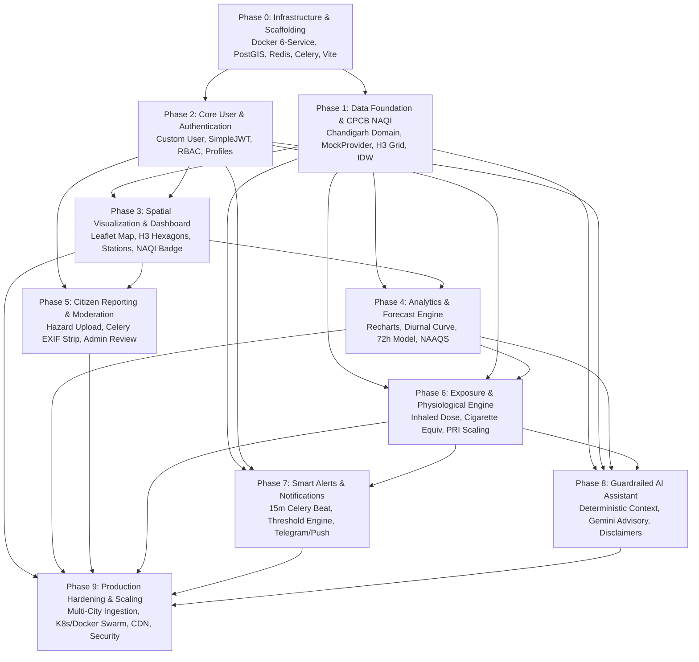

# BreatheWise: Phased Development Roadmap
## Comprehensive Phase 0 Through Phase 9 Implementation Roadmap for the BreatheWise Urban Air Quality Platform

**Document Identifier**: `DEVELOPMENT_ROADMAP.md`  
**System Name**: BreatheWise Urban Air Quality Assistance Platform  
**Target Region**: Chandigarh Urban Agglomeration (30.65°N–30.80°N, 76.70°E–76.85°E) with Pan-India Scalability  
**Standard Compliance**: Central Pollution Control Board (CPCB) National Air Quality Index (NAQI) Standard  
**Document Version**: 2.0.0  
**Status**: Authoritative Technical Execution Roadmap  

---

## Table of Contents
1. [Executive Roadmap Architecture & Phase Milestones](#1-executive-roadmap-architecture--phase-milestones)
2. [Phase Dependency Graph & Critical Path](#2-phase-dependency-graph--critical-path)
3. [Phase 0: Infrastructure Scaffolding, Container Topology & Health Checks](#3-phase-0-infrastructure-scaffolding-container-topology--health-checks)
4. [Phase 1: Data Foundation, Spatial Grid & Chandigarh Domain Setup](#4-phase-1-data-foundation-spatial-grid--chandigarh-domain-setup)
5. [Phase 2: Core Identity, Authentication & Role-Based Access Control](#5-phase-2-core-identity-authentication--role-based-access-control)
6. [Phase 3: Interactive Geospatial Visualization & Citizen Dashboard](#6-phase-3-interactive-geospatial-visualization--citizen-dashboard)
7. [Phase 4: Analytics Engine, Diurnal Dynamics & 72-Hour Forecasting](#7-phase-4-analytics-engine-diurnal-dynamics--72-hour-forecasting)
8. [Phase 5: Crowdsourced Citizen Reporting, EXIF Sanitization & Moderation](#8-phase-5-crowdsourced-citizen-reporting-exif-sanitization--moderation)
9. [Phase 6: Physiological Exposure Tracking & Personal Risk Index Engine](#9-phase-6-physiological-exposure-tracking--personal-risk-index-engine)
10. [Phase 7: Smart Threshold Alerts, Quiet Hours & Multi-Channel Dispatch](#10-phase-7-smart-threshold-alerts-quiet-hours--multi-channel-dispatch)
11. [Phase 8: Guardrailed AI Assistant & Contextual Natural Language Advisory](#11-phase-8-guardrailed-ai-assistant--contextual-natural-language-advisory)
12. [Phase 9: Production Hardening, Multi-City Scaling & Deployment](#12-phase-9-production-hardening-multi-city-scaling--deployment)
13. [Cross-Phase Governance, Release Gates & Risk Management](#13-cross-phase-governance-release-gates--risk-management)

---

## 1. Executive Roadmap Architecture & Phase Milestones

The BreatheWise development lifecycle is organized into ten discrete, sequential, and independently verifiable phases (Phase 0 through Phase 9). This engineering blueprint adheres to strict principles of modularity, computational determinism, and privacy-by-design.

Every phase establishes clear:
- **Phase Objectives**: The strategic and engineering capabilities unlocked.
- **Pre-requisite Dependencies**: Strict phase gates required prior to commencement.
- **Concrete Deliverables**: Code artifacts, configurations, migrations, and test suites.
- **Detailed Technical Tasks**: Granular execution items covering schema, business logic, API endpoints, UI components, and async jobs.
- **Verification Commands**: Exact CLI, test, and curl commands to independently validate phase integrity.
- **Acceptance Criteria**: Binary pass/fail validation benchmarks.

### Phase Summary Matrix

| Phase | Designation | Primary Focus & Domain | Target Sprint / Scope | Key Deliverables |
|---|---|---|---|---|
| **Phase 0** | Core Scaffolding | 6-Service Docker Compose, Django 5.1/PostGIS, Redis, Celery, React/Vite | Setup & Baseline | Container cluster, DB extensions, Vite template, health check API |
| **Phase 1** | Data Foundation | Chandigarh bounding box, H3 res 7/8, MockProvider, CPCB NAQI calculation engine | Atmospheric Core | 4 CAAQMS station fixtures, CPCB sub-index math, IDW spatial interpolation |
| **Phase 2** | Identity & Auth | Custom User, UserProfile, SimpleJWT, RBAC roles, Saved Locations | Security & Profile | Auth endpoints, JWT lifecycle, health vulnerability schema, H3 privacy |
| **Phase 3** | Geospatial & UI | Leaflet 1.9 map, H3 choropleth, station popups, real-time NAQI badge | Frontend Presentation | Map view, hex renderer, station modal, dashboard command center |
| **Phase 4** | Analytics & Forecast | Recharts visualizations, diurnal cycles, NAAQS benchmarks, 72h forecast | Data Intelligence | Diurnal chart, multi-pollutant line chart, 72h forecast curves with CIs |
| **Phase 5** | Citizen Reporting | Incident submissions, EXIF stripping Celery task, admin moderation | Civic Engagement | Report submission, async image sanitizer, moderation table, status badge |
| **Phase 6** | Exposure Engine | Inhaled dose formula, activity logs, mask filtration, PRI calculation | Physiological Health | Pure-Python dose engine, cigarette equivalence, daily exposure rollup |
| **Phase 7** | Smart Alerts | Threshold evaluation loop, quiet hours, Telegram bot, Web Push | Proactive Safety | Celery Beat 15m alert job, preference settings, multi-channel dispatch |
| **Phase 8** | AI Advisory | Contextual natural language advisory with strict mathematical guardrails | Assisted Guidance | LLM advisory generator, prompt sanitizer, hallucination-free rule engine |
| **Phase 9** | Production Scaling | Pan-India multi-city expansion, CDN caching, security audit, deployment | Production Readiness | Helm/K8s manifests, production Dockerfile, rate limit tiers, audit pass |

---

## 2. Phase Dependency Graph & Critical Path



---

## 3. Phase 0: Infrastructure Scaffolding, Container Topology & Health Checks

### 3.1 Objectives
1. Establish a reproducible, containerized local and staging environment containing all 6 microservices: `frontend`, `web`, `db`, `redis`, `worker`, and `beat`.
2. Configure PostgreSQL 16 with PostGIS 3.4 and `uuid-ossp` spatial extensions.
3. Configure Django 5.1 with GeoDjango, Django REST Framework, and Celery 5.4 async task bindings.
4. Set up React 18 with Vite 5, TypeScript 5, Tailwind CSS, Lucide icons, and Axios API client.
5. Provide centralized liveness and readiness health check endpoints for container orchestration.

### 3.2 Pre-requisite Dependencies
- Docker Engine 24.0+ and Docker Compose v2.20+.
- Node.js 20 LTS and Python 3.12 local runtimes (for development toolchains).
- Git repository initialized with `.gitignore`, `.editorconfig`, and directory skeletons.

### 3.3 Deliverables
- `docker-compose.yml` defining networks, volume mounts, resource constraints, and service dependencies.
- `backend/` directory with Django project `config/`, `manage.py`, `requirements.txt`, and base settings.
- `backend/common/health.py` implementing `/api/v1/health/` validating DB connection, PostGIS availability, and Redis ping.
- `frontend/` directory with Vite configuration, `package.json`, `tsconfig.json`, `tailwind.config.js`, and basic shell.
- Environment templates: `.env.example`, `.env.docker`.

### 3.4 Detailed Technical Tasks
- **TASK-0.1**: Create `docker-compose.yml` with 6 services:
  - `frontend`: Node 20 alpine or Nginx serving Vite build on port 5173 / 80.
  - `web`: Python 3.12 slim running Gunicorn/Uvicorn on port 8000 with volume bind-mount.
  - `db`: `postgis/postgis:16-3.4` on port 5432 with persistent volume `pgdata`.
  - `redis`: `redis:7.2-alpine` on port 6379 with persistent volume `redisdata`.
  - `worker`: Celery worker running `celery -A config worker -l INFO -c 4`.
  - `beat`: Celery beat scheduler running `celery -A config beat -l INFO`.
- **TASK-0.2**: Initialize PostgreSQL initialization script `init-db.sh` executing `CREATE EXTENSION IF NOT EXISTS postgis; CREATE EXTENSION IF NOT EXISTS "uuid-ossp";`.
- **TASK-0.3**: Configure Django `settings/base.py`, `settings/development.py`, and `settings/production.py` supporting `DATABASE_URL` via `dj-database-url`, GeoDjango `django.contrib.gis.db.backends.postgis`, and Redis cache `django-redis`.
- **TASK-0.4**: Initialize React 18 SPA with Vite, install `@tailwindcss/forms`, `@tailwindcss/typography`, `lucide-react`, `clsx`, `tailwind-merge`.
- **TASK-0.5**: Implement `GET /api/v1/health/` returning HTTP 200 with JSON payload:
  `{"status": "healthy", "database": "connected", "postgis": "3.4.0", "redis": "connected", "timestamp": "..."}`.

### 3.5 Verification Commands
```bash
# Start all 6 services
docker compose up -d --build

# Verify all containers are running and healthy
docker compose ps

# Verify database PostGIS extension
docker compose exec db psql -U postgres -d breathewise -c "SELECT PostGIS_Full_Version();"

# Verify Redis ping
docker compose exec redis redis-cli ping

# Verify Celery worker connection
docker compose exec worker celery -A config inspect ping

# Verify API health endpoint
curl -s -X GET http://localhost:8000/api/v1/health/ | jq .

# Verify frontend dev server
curl -s -I http://localhost:5173/ | grep "HTTP/1.1 200 OK"
```

### 3.6 Acceptance Criteria
- [ ] All 6 containers start cleanly without exit codes or crash loops.
- [ ] PostGIS version returns 3.4+ and spatial types (`PointField`, `PolygonField`) compile without GDAL/GEOS link errors.
- [ ] `/api/v1/health/` returns HTTP 200 with all dependencies reporting `"connected"`.
- [ ] Frontend boots at `http://localhost:5173` with hot-module reload functional.

---

## 4. Phase 1: Data Foundation, Spatial Grid & Chandigarh Domain Setup

### 4.1 Objectives
1. Model the geographic domain of Chandigarh Urban Agglomeration (30.65°N–30.80°N, 76.70°E–76.85°E).
2. Establish the 4 official CAAQMS monitoring stations in PostGIS:
   - Sector 22 (Station Code: `CH-SEC22`) — Mixed Commercial/Residential.
   - Sector 25 (Station Code: `CH-SEC25`) — Panjab University Campus.
   - Sector 53 (Station Code: `CH-SEC53`) — Southern Corridor / Transit Hub.
   - Sector 39 (Station Code: `CH-SEC39`) — Water Works / Green Belt.
3. Build the pluggable Data Provider Layer with abstract interfaces and a deterministic `MockAirQualityProvider` modeling realistic diurnal atmospheric boundary layer physics.
4. Implement the pure-Python Indian CPCB NAQI calculation engine for all 8 criteria pollutants with piecewise linear interpolation, the 3-pollutant validation rule, and the particulate mandate.
5. Implement the Uber H3 discrete global grid indexer (Resolution 7 and 8) and Inverse Distance Weighting (IDW) spatial interpolation engine.

### 4.2 Pre-requisite Dependencies
- Phase 0 completed and verified.
- PostgreSQL/PostGIS container operational with GDAL/GEOS libraries linked.

### 4.3 Deliverables
- Django app: `apps.locations` with `MonitoringStation`, `Location` models and Chandigarh fixtures.
- Django app: `apps.air_quality` with `AirQualityReading` model.
- Core package: `breathewise_core.providers` defining `BaseAirQualityProvider`, `BaseWeatherProvider`, and `MockAirQualityProvider`.
- Core package: `breathewise_core.engines.naqi` implementing official CPCB piecewise linear interpolation.
- Core package: `breathewise_core.spatial.h3_grid` and `breathewise_core.spatial.idw` implementing H3 cell generation and IDW interpolation.
- REST endpoints:
  - `GET /api/v1/locations/stations/`
  - `GET /api/v1/locations/stations/{id}/`
  - `GET /api/v1/air-quality/latest/`
  - `GET /api/v1/air-quality/h3/{h3_index}/`
  - `GET /api/v1/air-quality/grid/`

### 4.4 Detailed Technical Tasks
- **TASK-1.1**: Author `apps/locations/models.py` with `MonitoringStation` containing PostGIS `PointField(srid=4326)`, station code, sector, operator, and installation date.
- **TASK-1.2**: Author deterministic seed fixture `backend/fixtures/chandigarh_stations.json` containing exact coordinates:
  - Sector 22: `POINT(76.7725 30.7350)`
  - Sector 25: `POINT(76.7580 30.7485)`
  - Sector 53: `POINT(76.7390 30.7180)`
  - Sector 39: `POINT(76.7450 30.7300)`
- **TASK-1.3**: Implement `breathewise_core/engines/naqi.py`:
  - Breakpoint matrices for $PM_{2.5}, PM_{10}, NO_2, SO_2, CO, O_3, NH_3, Pb$.
  - Sub-index piecewise linear formula: $I_p = I_{lo} + \frac{I_{hi} - I_{lo}}{B_{hi} - B_{lo}} \times (C_p - B_{lo})$.
  - Validation enforcement: Minimum 3 pollutants required; at least one must be $PM_{2.5}$ or $PM_{10}$; returns `NAQI_INSUFFICIENT_DATA` if criteria unmet.
  - Overall NAQI = $\max(I_1, \dots, I_k)$; prominent pollutant selection with $PM_{2.5}$ tie-breaking.
- **TASK-1.4**: Implement `MockAirQualityProvider`:
  - Generates realistic sinusoidal diurnal variations: morning traffic peak (08:00–10:00), nocturnal winter inversion surge (21:00–04:00), afternoon thermal convective dispersion (13:00–16:00).
  - Deterministic time-seeded outputs so test suites yield exact repeatable values.
- **TASK-1.5**: Implement H3 hexagonal grid generator (`breathewise_core/spatial/h3_grid.py`) for Chandigarh bounding box (`[30.65, 76.70, 30.80, 76.85]`), yielding ~65 Resolution 8 cells (~0.737 km² each).
- **TASK-1.6**: Implement IDW interpolation (`breathewise_core/spatial/idw.py`) using great-circle distance (Haversine) from station coordinates to cell centroids with distance decay power $p=2.0$.
- **TASK-1.7**: Expose DRF views in `apps/air_quality/views.py` with 15-minute Redis caching.

### 4.5 Verification Commands
```bash
# Load Chandigarh station fixtures
docker compose exec web python manage.py loaddata backend/fixtures/chandigarh_stations.json

# Run CPCB NAQI calculation engine unit test suite
docker compose exec web pytest tests/unit/test_naqi_engine.py -v

# Run IDW and H3 spatial interpolation test suite
docker compose exec web pytest tests/spatial/test_h3_interpolation.py -v

# Query station list endpoint
curl -s http://localhost:8000/api/v1/locations/stations/ | jq '.data[0]'

# Query latest grid interpolation
curl -s http://localhost:8000/api/v1/air-quality/grid/ | jq '.data.cells[0]'
```

### 4.6 Acceptance Criteria
- [ ] 4 Chandigarh CAAQMS stations correctly seeded in PostGIS.
- [ ] CPCB NAQI sub-index calculation matches official CPCB guidelines across all 8 pollutants to within 0.1 index units.
- [ ] NAQI calculation rejects reading sets with <3 pollutants or lacking $PM_{2.5}/PM_{10}$ with `NAQI_INSUFFICIENT_DATA`.
- [ ] H3 Resolution 8 grid generates full hexagonal coverage of Chandigarh without spatial holes.
- [ ] `/api/v1/air-quality/grid/` returns valid GeoJSON feature collection with computed NAQI values and prominent pollutants.

---

## 5. Phase 2: Core Identity, Authentication & Role-Based Access Control

### 5.1 Objectives
1. Implement custom User model extending Django's `AbstractUser` with UUID primary keys and email-based authentication.
2. Implement `UserProfile` storing demographic categories, health vulnerability sensitivity profiles (Asthma, COPD, Cardiovascular, Pregnancy, Elderly, Pediatric), and notification toggles.
3. Configure JSON Web Token (SimpleJWT) authentication with short-lived access tokens (15 minutes), sliding refresh tokens (7 days), and token blacklisting on logout.
4. Establish Role-Based Access Control (RBAC) tiers: `CITIZEN`, `HEALTH_VULNERABLE`, `OFFICER` (CPCC/Municipal), and `ADMIN`.
5. Implement `SavedLocation` management with strict H3 cell resolution (Resolution 8) to preserve user privacy (zero raw GPS storage).

### 5.2 Pre-requisite Dependencies
- Phase 0 and Phase 1 completed.
- Relational schema defined in `DATABASE_SCHEMA.md`.

### 5.3 Deliverables
- Django app: `apps.accounts` with `User`, `UserProfile` models and admin registrations.
- Django app: `apps.locations` extended with `SavedLocation` model.
- Serializers and views for registration, login, token refresh, token blacklist, user profile CRUD, and saved location CRUD.
- Frontend authentication state store (`useAuthStore`) via Zustand with secure token persistence in memory/localStorage.
- Route guards: `<ProtectedRoute>` and `<RoleGate>`.

### 5.4 Detailed Technical Tasks
- **TASK-2.1**: Author `apps/accounts/models.py`:
  - `User(AbstractUser)`: UUIDv4 `id`, `email` unique, `role` (CITIZEN, OFFICER, ADMIN).
  - `UserProfile`: OneToOneField to `User`, `sensitivity_profile` (GENERAL, SENSITIVE_RESPIRATORY, SENSITIVE_CARDIAC, PEDIATRIC, ELDERLY, PREGNANT), `asthma_diagnosed` (boolean), `copd_diagnosed` (boolean), `daily_activity_level` (SEDENTARY, MODERATE, HIGH).
- **TASK-2.2**: Configure `djangorestframework-simplejwt`:
  - Token claims: `user_id`, `email`, `role`, `sensitivity_profile`.
  - Token blacklisting enabled in PostgreSQL (`outstanding_token`, `blacklisted_token`).
- **TASK-2.3**: Implement DRF endpoints in `apps/accounts/views.py`:
  - `POST /api/v1/auth/register/` (creates User + UserProfile in transaction)
  - `POST /api/v1/auth/login/` (validates credentials, returns access & refresh tokens)
  - `POST /api/v1/auth/refresh/` (issues new access token)
  - `POST /api/v1/auth/logout/` (blacklists refresh token)
  - `GET /api/v1/users/me/` and `PATCH /api/v1/users/me/`
  - `GET /api/v1/users/me/profile/` and `PUT /api/v1/users/me/profile/`
- **TASK-2.4**: Implement `apps/locations/models.py` `SavedLocation`:
  - `user_id` (FK to User), `label` (e.g. "Home", "Office"), `h3_index` (VARCHAR(20), H3 Res 8), `sector_name` (optional label).
  - Explicit constraint: NO latitude/longitude columns allowed.
  - Endpoints: `GET /api/v1/locations/saved/`, `POST /api/v1/locations/saved/`, `DELETE /api/v1/locations/saved/{id}/`.
- **TASK-2.5**: Implement frontend `frontend/src/store/useAuthStore.ts` and React login/register/profile pages.

### 5.5 Verification Commands
```bash
# Run database migrations for accounts and locations
docker compose exec web python manage.py makemigrations accounts locations
docker compose exec web python manage.py migrate

# Run authentication and RBAC test suite
docker compose exec web pytest tests/integration/test_auth_api.py -v

# Test user registration via curl
curl -s -X POST http://localhost:8000/api/v1/auth/register/ \
  -H "Content-Type: application/json" \
  -d '{"email": "priya@example.com", "password": "SecurePassword123!", "name": "Priya Sharma", "role": "CITIZEN"}' | jq .

# Test token refresh
curl -s -X POST http://localhost:8000/api/v1/auth/refresh/ \
  -H "Content-Type: application/json" \
  -d '{"refresh": "<REFRESH_TOKEN>"}' | jq .

# Test saved location creation (H3 index only)
curl -s -X POST http://localhost:8000/api/v1/locations/saved/ \
  -H "Authorization: Bearer <ACCESS_TOKEN>" \
  -H "Content-Type: application/json" \
  -d '{"label": "Home", "h3_index": "881e205097fffff", "sector_name": "Sector 22-B"}' | jq .
```

### 5.6 Acceptance Criteria
- [ ] Users can register, log in, and receive valid SimpleJWT access and refresh tokens.
- [ ] Logged-out tokens are added to the database blacklist; reuse attempts return HTTP 401 Unauthorized.
- [ ] Role permissions prevent regular `CITIZEN` users from accessing `OFFICER` or `ADMIN` endpoints.
- [ ] `SavedLocation` table schema contains zero geometry/coordinate columns, storing exclusively H3 indices.
- [ ] Frontend persists session securely and handles automatic token refresh on 401 response interceptors.

---

## 6. Phase 3: Interactive Geospatial Visualization & Citizen Dashboard

### 6.1 Objectives
1. Construct the Leaflet 1.9 interactive map bounded to the Chandigarh Urban Agglomeration (30.65°N–30.80°N, 76.70°E–76.85°E) with smooth pan/zoom boundaries.
2. Render dynamic Uber H3 Resolution 8 hexagonal choropleth polygons styled according to official Indian CPCB NAQI color tokens with opacity controls.
3. Display CAAQMS monitoring station markers with live pulsing rings indicating current NAQI health category and interactive detail modal popups.
4. Build the citizen Dashboard Command Center featuring the live NAQI summary card, prominent pollutant badge, quick health advisory, and saved location air quality tickers.
5. Ensure full accessibility (WCAG 2.1 AA) with high-contrast text overlays, screen-reader labels, and the mandatory yellow band contrast rule (`#B2A100` / `#222222`).

### 6.2 Pre-requisite Dependencies
- Phase 1 (Data Foundation & Grid API) and Phase 2 (Authentication & Saved Locations) completed.
- `FRONTEND_DESIGN.md` design tokens and component hierarchy approved.

### 6.3 Deliverables
- React components: `LeafletMap.tsx`, `H3HexagonLayer.tsx`, `StationMarker.tsx`, `StationModal.tsx`.
- Dashboard components: `AqiBadge.tsx`, `PollutantBreakdownGrid.tsx`, `HealthAdvisoryCard.tsx`, `SavedLocationsTicker.tsx`.
- TanStack Query hooks: `useAirQualityGrid()`, `useStations()`, `useLatestReading()`.
- Responsive layout supporting desktop (1440px), tablet (768px), and mobile (375px) viewports.

### 6.4 Detailed Technical Tasks
- **TASK-3.1**: Initialize `LeafletMap.tsx` using `react-leaflet` with CartoDB Positron / OSM tiles, constrained with `maxBounds`: `[[30.60, 76.65], [30.85, 76.90]]`, `minZoom: 11`, `maxZoom: 16`.
- **TASK-3.2**: Implement `H3HexagonLayer.tsx`:
  - Fetches GeoJSON from `/api/v1/air-quality/grid/` via TanStack Query with 60-second stale time.
  - Computes boundary polygon coordinates for H3 Resolution 8 cells via `h3-js`.
  - Sets fillColor based on CPCB NAQI categories:
    - Good (0–50): `#00B050`
    - Satisfactory (51–100): `#92D050`
    - Moderate (101–200): `#FFFF00`
    - Poor (201–300): `#FF9900`
    - Very Poor (301–400): `#FF0000`
    - Severe (401–500+): `#C00000`
  - Applies 0.45 polygon fill opacity with hover highlight (0.75 fill, 2px white stroke).
- **TASK-3.3**: Implement `StationMarker.tsx`:
  - Renders custom SVG Leaflet DivIcon with pulsing CSS animation ring colored by current station NAQI.
  - Clicking marker triggers `StationModal.tsx` showing all 8 criteria pollutant sub-indices, 24-hour trend sparkline, and station operator metadata.
- **TASK-3.4**: Implement Dashboard Command Center view (`DashboardView.tsx`):
  - Primary AQI gauge with numerical index and text descriptor.
  - Grid of 6–8 pollutant mini-cards displaying concentration ($\mu\text{g/m}^3$) and sub-index.
  - Personalized advisory snippet linked to user's registered sensitivity profile.
- **TASK-3.5**: Implement WCAG 2.1 AA text contrast validation: For any `#FFFF00` (Moderate) badge, text color must be `#1F2937` (dark slate), never white.

### 6.5 Verification Commands
```bash
# Run frontend unit and component tests with Vitest
cd frontend && npm run test:unit -- src/components/map/H3HexagonLayer.test.tsx

# Run visual accessibility tests (axe-core)
cd frontend && npm run test:a11y

# Start frontend development server and inspect in browser
npm run dev
```

### 6.6 Acceptance Criteria
- [ ] Map loads centered at Chandigarh (`30.7333°N, 76.7794°E`) and restricts panning outside the greater Tricity envelope.
- [ ] H3 hexagonal cells render seamlessly over the city with correct CPCB NAQI category colors.
- [ ] Clicking any station marker displays real-time pollutant sub-indices and prominent pollutant flag.
- [ ] Dashboard displays accurate current NAQI badge with dark text on yellow Moderate badge, meeting WCAG 2.1 AA contrast ($\ge 4.5:1$).
- [ ] TanStack Query automatically polls and refreshes map and dashboard telemetry every 60 seconds without full page reload.

---

## 7. Phase 4: Analytics Engine, Diurnal Dynamics & 72-Hour Forecasting

### 7.1 Objectives
1. Build the historical data aggregation and analytics engine for multi-pollutant trend analysis and National Ambient Air Quality Standards (NAAQS) regulatory compliance tracking.
2. Compute and visualize 24-hour diurnal atmospheric cycles revealing morning/evening rush hour peaks and nocturnal planetary boundary layer compression.
3. Implement the 72-hour hourly predictive forecast engine generating forecast curves with statistical confidence bands ($CI_{low}, CI_{high}$).
4. Deliver high-performance Recharts visualizations with custom tooltip formatters, threshold reference lines, and responsive SVG containers.

### 7.2 Pre-requisite Dependencies
- Phase 1 (Data Foundation) and Phase 3 (UI Architecture) completed.
- `DATABASE_SCHEMA.md` model `AQIForecast` (`forecasting_aqiforecast`) defined.

### 7.3 Deliverables
- Django app: `apps.analytics` with trend aggregation service and NAAQS compliance calculator.
- Django app: `apps.forecasting` with `AQIForecast` model and predictive time-series service.
- REST endpoints:
  - `GET /api/v1/analytics/trends/`
  - `GET /api/v1/analytics/diurnal/`
  - `GET /api/v1/analytics/naaqs-compliance/`
  - `GET /api/v1/forecast/hourly/`
  - `GET /api/v1/forecast/daily/`
- React visualization views: `AnalyticsView.tsx`, `DiurnalChart.tsx`, `ForecastView.tsx`, `ConfidenceBandChart.tsx`.

### 7.4 Detailed Technical Tasks
- **TASK-4.1**: Implement `apps/analytics/services.py`:
  - `get_historical_trends(station_code, range)`: Aggregates hourly/daily averages for $PM_{2.5}, PM_{10}, NO_2, SO_2, CO, O_3$.
  - `get_diurnal_profile(station_code, days)`: Calculates 24-hour mean and standard deviation for each hour of the day (00:00 to 23:00) over the requested window.
  - `get_naaqs_compliance(station_code, year)`: Computes percentage of days exceeding the 24-hour NAAQS limits ($PM_{2.5} > 60 \mu\text{g/m}^3, PM_{10} > 100 \mu\text{g/m}^3$).
- **TASK-4.2**: Implement `apps/forecasting/services.py`:
  - Predicts 72 hours of hourly NAQI and primary pollutant concentrations based on persistence, meteorological diurnal modeling, and boundary layer physics.
  - Generates upper and lower 95% confidence intervals: $CI_{low}(t) = \max(0, \hat{y}(t) - 1.96 \cdot \sigma(t))$, $CI_{high}(t) = \hat{y}(t) + 1.96 \cdot \sigma(t)$ where uncertainty $\sigma(t)$ scales with forecast horizon $t$.
- **TASK-4.3**: Implement `DiurnalChart.tsx` using Recharts:
  - Area chart displaying 24-hour diurnal profile with distinct shading for morning peak (08:00–10:00) and evening peak (19:00–22:00).
  - Synchronized tooltip showing mean concentration and standard deviation.
- **TASK-4.4**: Implement `ConfidenceBandChart.tsx` using Recharts:
  - Composed line and area chart rendering predicted NAQI line with shaded confidence envelope between $CI_{low}$ and $CI_{high}$.
  - Horizontal reference lines at CPCB category boundaries (50, 100, 200, 300, 400).
- **TASK-4.5**: Expose endpoints with Redis caching (1-hour TTL for historical trends, 30-minute TTL for forecasts).

### 7.5 Verification Commands
```bash
# Run analytics and forecasting test suite
docker compose exec web pytest tests/unit/test_analytics.py tests/unit/test_forecasting.py -v

# Test diurnal profile endpoint
curl -s "http://localhost:8000/api/v1/analytics/diurnal/?station_code=CH-SEC22&days=7" | jq '.data[0]'

# Test 72-hour forecast endpoint
curl -s "http://localhost:8000/api/v1/forecast/hourly/?station_code=CH-SEC22&hours=72" | jq '.data[0]'

# Test NAAQS compliance metrics endpoint
curl -s "http://localhost:8000/api/v1/analytics/naaqs-compliance/?station_code=CH-SEC22&year=2024" | jq .
```

### 7.6 Acceptance Criteria
- [ ] Diurnal analytics accurately reflect 24-hour cycle with distinct morning and evening traffic/inversion peaks.
- [ ] 72-hour forecast returns monotonically expanding confidence bands as forecast horizon increases.
- [ ] NAAQS compliance correctly flags exceedance days against Indian 24-hour regulatory standards.
- [ ] Recharts frontend visualizes multi-pollutant trends and confidence bands smoothly across desktop and mobile screens.

---

## 8. Phase 5: Crowdsourced Citizen Reporting, EXIF Sanitization & Moderation

### 8.1 Objectives
1. Implement citizen incident reporting for hyper-local environmental hazards (open biomass/garbage burning, industrial smoke, construction dust, vehicular exhaust).
2. Enforce strict privacy-by-design for citizen submissions: fuzz user GPS location to H3 Resolution 8 cell index prior to persistence.
3. Build an asynchronous Celery task pipeline to strip all EXIF metadata (GPS tags, device model, camera serial numbers, original timestamps) from uploaded evidence photos.
4. Provide an administrative moderation console for Municipal Environmental Officers (CPCC / MC Chandigarh) to verify, resolve, or flag reported incidents.
5. Display crowdsourced hazard pins on the interactive map with status badges (`PENDING`, `VERIFIED`, `RESOLVED`, `REJECTED`).

### 8.2 Pre-requisite Dependencies
- Phase 2 (Authentication & RBAC) and Phase 3 (Leaflet Map) completed.
- Celery worker and Redis broker operational.
- Pillow (PIL) Python image processing library installed.

### 8.3 Deliverables
- Django app: `apps.reports` with `PollutionReport` and `ReportImage` models.
- Celery task: `apps.reports.tasks.sanitize_report_image_exif`.
- REST endpoints:
  - `POST /api/v1/reports/` (multipart form upload)
  - `GET /api/v1/reports/` (filtered by H3 cell, status, date)
  - `GET /api/v1/reports/{id}/`
  - `PATCH /api/v1/reports/{id}/moderate/` (Officer/Admin only)
- Frontend views: `ReportHazardModal.tsx`, `AdminModerationTable.tsx`, `HazardMapOverlay.tsx`.

### 8.4 Detailed Technical Tasks
- **TASK-5.1**: Author `apps/reports/models.py`:
  - `PollutionReport`: UUID, `user` (FK to User, nullable for anonymous), `hazard_type` (BIOMASS_BURNING, INDUSTRIAL_SMOKE, CONSTRUCTION_DUST, VEHICULAR_EMISSION, OTHER), `description`, `h3_index` (VARCHAR(20), Res 8), `status` (PENDING, VERIFIED, RESOLVED, REJECTED), `moderated_by` (FK to User), `moderated_at`, `created_at`.
  - `ReportImage`: UUID, `report` (FK to PollutionReport), `image` (ImageField), `sanitized` (boolean), `uploaded_at`.
- **TASK-5.2**: Implement Celery task `sanitize_report_image_exif(image_id)`:
  - Opens image with Pillow (`PIL.Image`).
  - Strips all EXIF tags (`image.getexif().clear()`), color profiles, and GPS IFD blocks.
  - Re-encodes image as clean JPEG/PNG with standard compression.
  - Overwrites storage file and marks `sanitized=True`.
- **TASK-5.3**: Enforce H3 privacy in report submission serializer:
  - Accepts either explicit `h3_index` or optional client `(latitude, longitude)`.
  - Converts coordinates to H3 Resolution 8 cell index immediately: `h3.geo_to_h3(lat, lon, 8)`.
  - Discards raw latitude and longitude variables from memory; never writes them to the database.
- **TASK-5.4**: Implement moderation endpoint `PATCH /api/v1/reports/{id}/moderate/`:
  - Enforces `IsAdminOrOfficer` permission gate.
  - Updates report status and records audit log.
- **TASK-5.5**: Add hazard marker layer to `LeafletMap.tsx`:
  - Renders colored flame/dust pin at H3 cell centroid with popup showing hazard type, report time, and sanitized evidence photo.

### 8.5 Verification Commands
```bash
# Run citizen reporting and EXIF sanitization test suite
docker compose exec web pytest tests/unit/test_reports_exif.py tests/integration/test_reports_api.py -v

# Submit hazard report with an image containing GPS EXIF tags
curl -s -X POST http://localhost:8000/api/v1/reports/ \
  -H "Authorization: Bearer <CITIZEN_TOKEN>" \
  -F "hazard_type=BIOMASS_BURNING" \
  -F "description=Severe garbage burning near Sector 25 dump" \
  -F "h3_index=881e205097fffff" \
  -F "image=@tests/fixtures/sample_with_exif.jpg" | jq .

# Verify EXIF is completely stripped from processed image
docker compose exec web python -c "
from PIL import Image
img = Image.open('media/reports/sanitized_sample.jpg')
exif = img.getexif()
assert len(exif) == 0, 'EXIF tags still present!'
print('EXIF sanitization verified: 0 tags found.')
"
```

### 8.6 Acceptance Criteria
- [ ] Uploaded images are sanitized asynchronously via Celery; zero EXIF tags (GPS, camera serial) remain in persisted images.
- [ ] Database contains zero raw latitude/longitude coordinates for citizen reports, persisting strictly H3 cell indices.
- [ ] Municipal officers can access the moderation console and transition reports from `PENDING` to `VERIFIED` or `RESOLVED`.
- [ ] Verified reports appear as map pins on the public interactive map within their respective H3 cells.

---

## 9. Phase 6: Physiological Exposure Tracking & Personal Risk Index Engine

### 9.1 Objectives
1. Implement the pure-Python deterministic inhalation dose calculation engine modeling physiological ventilation rates ($V_E$), physical activity levels, exposure durations, and protective mask filtration efficiencies ($\eta$).
2. Implement cigarette smoke equivalence formulation mapping microgram particulate intake to equivalent smoked cigarettes based on standardized biomedical benchmarks.
3. Formulate the Personal Risk Index ($PRI$) synthesizing cumulative particulate intake with individual demographic vulnerability profiles (Asthma, COPD, Cardiovascular, Pediatric, Elderly, Pregnancy).
4. Provide activity logging APIs and daily exposure rollup jobs via Celery.
5. Render intuitive frontend visualization gauges for cumulative dose, cigarette equivalence counter, and personalized safety advisory alerts.

### 9.2 Pre-requisite Dependencies
- Phase 1 (NAQI engine), Phase 2 (User Profiles), and Phase 4 (Analytics) completed.
- `SYSTEM_ARCHITECTURE.md` Section 5 physiological baselines approved.

### 9.3 Deliverables
- Core package: `breathewise_core.engines.impact` implementing dose, cigarette equivalence, and PRI formulas.
- Config module: `breathewise_core.engines.impact_config_v1` defining minute ventilation baselines and mask ratings.
- Django app: `apps.exposure` with `ExposureRecord` model and daily rollup Celery task.
- REST endpoints:
  - `POST /api/v1/exposure/activities/`
  - `GET /api/v1/exposure/daily/`
  - `GET /api/v1/exposure/summary/`
- React components: `ExposureTrackerCard.tsx`, `CigaretteEquivWidget.tsx`, `PersonalRiskGauge.tsx`, `LogActivityModal.tsx`.

### 9.4 Detailed Technical Tasks
- **TASK-6.1**: Implement `breathewise_core/engines/impact_config_v1.py`:
  - Minute ventilation rates ($V_E$ in $m^3/\text{minute}$):
    - Sedentary / Resting: $0.008 \text{ m}^3/\text{min}$ ($0.48 \text{ m}^3/\text{h}$)
    - Light / Walking: $0.020 \text{ m}^3/\text{min}$ ($1.20 \text{ m}^3/\text{h}$)
    - Moderate / Cycling: $0.040 \text{ m}^3/\text{min}$ ($2.40 \text{ m}^3/\text{h}$)
    - Vigorous / Running: $0.060 \text{ m}^3/\text{min}$ ($3.60 \text{ m}^3/\text{h}$)
  - Mask penetration reduction efficiencies ($\eta$):
    - None: $0.00$
    - Cloth Mask: $0.20$ (20% filtration)
    - Surgical Mask: $0.50$ (50% filtration)
    - N95 / FFP2 Respirator: $0.95$ (95% filtration)
    - N99 Respirator: $0.99$ (99% filtration)
  - Cigarette Equivalence factor: $1 \text{ cigarette} \equiv 22 \mu\text{g/m}^3 \times 24\text{ hours} \approx 216 \mu\text{g } PM_{2.5}$ total inhaled particulate mass.
  - Demographic Sensitivity Multipliers ($S$):
    - GENERAL: $1.00$
    - SENSITIVE_RESPIRATORY (Asthma): $1.85$
    - SENSITIVE_RESPIRATORY (COPD): $2.20$
    - SENSITIVE_CARDIAC: $1.90$
    - PEDIATRIC ($\le 12$ yrs): $1.65$
    - ELDERLY ($\ge 65$ yrs): $1.70$
    - PREGNANT: $1.50$
- **TASK-6.2**: Implement `breathewise_core/engines/impact.py`:
  - $\text{Dose}(\mu\text{g}) = C_{PM2.5} \times V_E \times t \times (1 - \eta)$
  - $\text{Cigarettes} = \frac{\text{Dose}(\mu\text{g})}{216.0}$
  - $PRI = \min\left(100.0, \frac{\text{Dose}}{D_{ref}} \times S \times 50.0\right)$ where $D_{ref} = 300.0 \mu\text{g}$ (WHO 24h benchmark baseline).
- **TASK-6.3**: Author `apps/exposure/models.py` `ExposureRecord`:
  - `user` (FK to User), `activity_type`, `duration_minutes`, `mask_type`, `h3_index`, `pm25_concentration`, `computed_dose_micrograms`, `cigarette_equivalent`, `pri_score`, `logged_at`.
- **TASK-6.4**: Implement daily exposure rollup Celery task `aggregate_daily_user_exposure` running at 23:59 UTC.
- **TASK-6.5**: Implement frontend exposure logging modal and gauge widgets with color-coded PRI score (0–30 Low/Green, 31–60 Moderate/Yellow, 61–85 High/Orange, 86–100 Extreme/Red).

### 9.5 Verification Commands
```bash
# Run pure-Python impact engine mathematical verification tests
docker compose exec web pytest tests/unit/test_impact_engine.py -v

# Run exposure API integration tests
docker compose exec web pytest tests/integration/test_exposure_api.py -v

# Log an outdoor running activity (45 mins in Sector 22, no mask)
curl -s -X POST http://localhost:8000/api/v1/exposure/activities/ \
  -H "Authorization: Bearer <USER_TOKEN>" \
  -H "Content-Type: application/json" \
  -d '{
    "activity_type": "RUNNING",
    "duration_minutes": 45,
    "mask_type": "NONE",
    "h3_index": "881e205097fffff"
  }' | jq .

# Fetch today's cumulative exposure summary
curl -s http://localhost:8000/api/v1/exposure/summary/ \
  -H "Authorization: Bearer <USER_TOKEN>" | jq .
```

### 9.6 Acceptance Criteria
- [ ] Inhalation dose calculates deterministically across all activity and mask combinations with zero floating point drift.
- [ ] Cigarette equivalence precisely maps inhaled particulate microgram mass to standardized cigarette unit metrics.
- [ ] Sensitive demographic profiles (Asthma, COPD) receive elevated PRI scores compared to general citizens for identical exposure durations.
- [ ] PRI score strictly caps at 100.0 without overflow under extreme pollution levels.
- [ ] Celery daily rollup aggregates total daily microgram dose and stores summary records accurately.

---

## 10. Phase 7: Smart Threshold Alerts, Quiet Hours & Multi-Channel Dispatch

### 10.1 Objectives
1. Implement the real-time threshold alert evaluation engine running every 15 minutes via Celery Beat.
2. Support custom user alert preferences: target H3 locations, NAQI category thresholds (e.g., alert when air drops to `Poor` or worse), and specific pollutant surge warnings ($PM_{2.5} > 150 \mu\text{g/m}^3$).
3. Enforce strict quiet-hours suppression rules (e.g., 22:00 to 07:00 IST) with emergency override triggers only when conditions reach `Severe` ($NAQI \ge 401$).
4. Implement multi-channel notification dispatchers: Telegram Bot adapter, Web Push notifications (VAPID), and transactional Email.
5. Maintain a persistent in-app notifications center with read/unread tracking.

### 10.2 Pre-requisite Dependencies
- Phase 1 (Readings), Phase 2 (Users), and Phase 6 (Exposure) completed.
- Celery Beat scheduler active and Redis queue functional.

### 10.3 Deliverables
- Django app: `apps.alerts` with `AlertPreference` and `Alert` models.
- Periodic Celery Beat task: `apps.alerts.tasks.evaluate_threshold_alerts`.
- Dispatcher modules: `breathewise_core.notifications.telegram`, `breathewise_core.notifications.webpush`.
- REST endpoints:
  - `GET /api/v1/alerts/preferences/`
  - `PUT /api/v1/alerts/preferences/`
  - `GET /api/v1/alerts/active/`
  - `POST /api/v1/alerts/{id}/read/`
  - `POST /api/v1/alerts/test/`
- React components: `AlertPreferencesView.tsx`, `NotificationCenterDropdown.tsx`, `AlertBanner.tsx`.

### 10.4 Detailed Technical Tasks
- **TASK-7.1**: Author `apps/alerts/models.py`:
  - `AlertPreference`: `user` (OneToOne to User), `h3_index`, `threshold_category` (MODERATE, POOR, VERY_POOR, SEVERE), `pm25_threshold` (optional float), `enable_telegram` (bool), `telegram_chat_id` (varchar), `enable_webpush` (bool), `webpush_subscription` (JSON), `quiet_hours_start` (TimeField, default "22:00"), `quiet_hours_end` (TimeField, default "07:00"), `emergency_override` (bool, default True).
  - `Alert`: `user` (FK to User), `h3_index`, `category`, `naqi_value`, `primary_pollutant`, `message`, `channel`, `sent_at`, `read_at`.
- **TASK-7.2**: Implement Celery periodic task `evaluate_threshold_alerts`:
  - Executes every 15 minutes (`crontab(minute='*/15')`).
  - Fetches latest H3 grid readings.
  - Queries active `AlertPreference` records.
  - Checks if current NAQI exceeds configured threshold.
  - Validates quiet hours against user's local timezone (Asia/Kolkata): Suppresses dispatch if within quiet window unless `emergency_override=True` and $NAQI \ge 401$ (Severe).
  - Deduplicates alerts: Ensures a user receives at most one alert per 3 hours for the same category unless air deteriorates further.
- **TASK-7.3**: Implement Telegram Bot dispatcher (`breathewise_core/notifications/telegram.py`):
  - In Phase 7 development, operates with `MockNotificationProvider` logging formatted messages.
  - Generates markdown alerts with NAQI badge emoji (🟢, 🟡, 🟠, 🔴, 🟣, 🟤), advice snippet, and action recommendations.
- **TASK-7.4**: Implement Web Push dispatcher using `pywebpush` with VAPID keys.
- **TASK-7.5**: Build in-app notification dropdown and preferences configuration UI in React.

### 10.5 Verification Commands
```bash
# Run alert rules and quiet-hours test suite
docker compose exec web pytest tests/unit/test_alert_engine.py tests/integration/test_alerts_api.py -v

# Trigger manual alert test via API
curl -s -X POST http://localhost:8000/api/v1/alerts/test/ \
  -H "Authorization: Bearer <USER_TOKEN>" \
  -H "Content-Type: application/json" \
  -d '{"channel": "IN_APP"}' | jq .

# Inspect Celery Beat scheduled tasks
docker compose exec web celery -A config inspect registered
```

### 10.6 Acceptance Criteria
- [ ] 15-minute periodic task detects when air quality crosses user-defined threshold and queues alerts.
- [ ] Quiet hours suppression blocks non-emergency notifications during configured night hours (22:00 to 07:00).
- [ ] Severe pollution ($NAQI \ge 401$) triggers emergency override and dispatches alert regardless of quiet hours.
- [ ] Anti-flapping deduplication prevents duplicate alerts within a 3-hour window for the same category.
- [ ] In-app notification center displays unread counter and marks alerts read upon user interaction.

---

## 11. Phase 8: AI Assistant & Guardrails (Contextual Natural Language Advisory)

### 11.1 Objectives
1. Implement the conversational AI Air Quality Assistant providing empathetic, contextual, and hyper-local health and activity advice for citizens of Chandigarh.
2. Establish non-negotiable mathematical guardrails: The Large Language Model (LLM) must **NEVER** calculate, predict, or alter numerical NAQI or inhaled dose values. All numbers are pre-calculated by the deterministic Python engines and injected into the prompt as immutable ground truth.
3. Enforce strict biomedical guardrails: The assistant must never diagnose illnesses or prescribe pharmaceuticals, appending mandatory regulatory disclaimers ("Not medical advice; consult a qualified physician").
4. Provide conversation persistence, message history, and token-bounded context management.
5. Implement interactive chat widget in the React frontend with suggested contextual prompt chips.

### 11.2 Pre-requisite Dependencies
- Phase 1 (NAQI), Phase 2 (User Profiles), Phase 4 (Forecast), and Phase 6 (Exposure) completed.
- `DATABASE_SCHEMA.md` models `ChatConversation` and `ChatMessage` defined.

### 11.3 Deliverables
- Django app: `apps.assistant` with `ChatConversation`, `ChatMessage` models.
- Guardrail engine: `breathewise_core.assistant.guardrails` and `breathewise_core.assistant.prompt_builder`.
- LLM adapter: `breathewise_core.assistant.llm_adapter` supporting deterministic `MockLLMProvider` and Google Gemini API contract.
- REST endpoints:
  - `GET /api/v1/assistant/conversations/`
  - `POST /api/v1/assistant/conversations/`
  - `GET /api/v1/assistant/conversations/{id}/messages/`
  - `POST /api/v1/assistant/conversations/{id}/messages/`
- React component: `AIAssistantDrawer.tsx` with streaming/typing UI, prompt chips, and medical disclaimer footer.

### 11.4 Detailed Technical Tasks
- **TASK-8.1**: Author `apps/assistant/models.py`:
  - `ChatConversation`: UUID, `user` (FK to User), `title`, `created_at`, `updated_at`.
  - `ChatMessage`: UUID, `conversation` (FK to ChatConversation), `role` (`user`, `assistant`, `system`), `content`, `context_snapshot` (JSON storing deterministic telemetry: NAQI, dose, station, profile at time of interaction), `created_at`.
- **TASK-8.2**: Implement `PromptContextBuilder` (`breathewise_core/assistant/prompt_builder.py`):
  - Fetches current station reading for user's sector/H3 cell.
  - Fetches 24h forecast summary.
  - Fetches user's active health profile (e.g., "68-year-old male with COPD diagnosis, current daily dose: 145 µg, PRI: 72/100 (High)").
  - Constructs immutable system prompt framing the assistant as an urban environmental health advisor.
- **TASK-8.3**: Implement Guardrail Enforcement (`breathewise_core/assistant/guardrails.py`):
  - Pre-generation check: Rejects malicious prompt injections attempting to override system constraints or request prescription drug dosage.
  - Post-generation validator: Scans generated text with regex to ensure the LLM did not hallucinate new AQI values contradicting ground-truth telemetry.
  - Enforces mandatory medical disclaimer: "Disclaimer: BreatheWise provides environmental health risk guidance, not medical diagnosis. If experiencing acute respiratory or cardiac symptoms, contact emergency medical services or consult your doctor immediately."
- **TASK-8.4**: Implement `MockLLMProvider`:
  - Returns structured, empathetic responses for test suites and offline operation without external API billing.
- **TASK-8.5**: Implement frontend `AIAssistantDrawer.tsx` with floating trigger button, animated typing indicator, markdown formatting, and suggested prompt chips ("Can I run in Sukhna Lake tomorrow morning?", "Should my child wear a mask to school today?").

### 11.5 Verification Commands
```bash
# Run AI assistant guardrails and prompt context test suite
docker compose exec web pytest tests/unit/test_assistant_guardrails.py tests/integration/test_assistant_api.py -v

# Create chat conversation
curl -s -X POST http://localhost:8000/api/v1/assistant/conversations/ \
  -H "Authorization: Bearer <USER_TOKEN>" \
  -H "Content-Type: application/json" \
  -d '{"title": "Morning Cycling Advice"}' | jq .

# Send user query to assistant
curl -s -X POST http://localhost:8000/api/v1/assistant/conversations/<CONVERSATION_ID>/messages/ \
  -H "Authorization: Bearer <USER_TOKEN>" \
  -H "Content-Type: application/json" \
  -d '{"message": "I plan to cycle 15km along Madhya Marg at 7 AM. Is it safe for my asthma?"}' | jq .
```

### 11.6 Acceptance Criteria
- [ ] System prompt injects pre-calculated NAQI, forecast, and PRI metrics; LLM does not perform independent numerical calculations.
- [ ] Post-generation guardrails reject medical prescription queries and append mandatory medical disclaimer.
- [ ] Conversations and full contextual telemetry snapshots persist in PostgreSQL for auditability.
- [ ] Frontend assistant drawer opens smoothly and renders formatted markdown guidance with suggested prompt chips.

---

## 12. Phase 9: Production Hardening, Multi-City Scaling & Deployment

### 12.1 Objectives
1. Harden the entire application stack for production readiness: security auditing, penetration test remediation, OWASP Top 10 compliance, and DPDP Act 2023 privacy attestation.
2. Scale the spatial ingestion and interpolation architecture to support multi-city expansion beyond Chandigarh (e.g. Delhi NCR, Mumbai, Bengaluru, Pune, Lucknow).
3. Implement production-grade Nginx reverse proxy configuration with TLS 1.3 termination, HTTP/2, Brotli compression, strict Content Security Policy (CSP), and CORS boundaries.
4. Configure production container orchestration with Kubernetes manifests (or Docker Swarm), automated rolling deployments, horizontal pod autoscaling (HPA), and persistent volume management.
5. Configure Prometheus metrics endpoints, Grafana monitoring dashboards, automated daily database backups, and disaster recovery runbooks.

### 12.2 Pre-requisite Dependencies
- All preceding phases (Phase 0 through Phase 8) complete and verified.
- Test coverage $\ge 80\%$ verified across all engine, auth, and API test suites.

### 12.3 Deliverables
- Infrastructure manifests: `deploy/k8s/` (Deployments, Services, Ingress, ConfigMaps, Secrets, HPA).
- Production Dockerfiles: `backend/Dockerfile.prod`, `frontend/Dockerfile.prod` (multi-stage optimized).
- Nginx configuration: `deploy/nginx/breathewise.conf` with security headers and SSL configuration.
- Telemetry: Prometheus exporter at `/metrics`, Grafana dashboard JSON models.
- Security audit report and DPDP Act compliance certificate.

### 12.4 Detailed Technical Tasks
- **TASK-9.1**: Multi-city spatial registry (`breathewise_core/spatial/city_registry.py`):
  - Extends H3 grid generation and bounding box clipping to support arbitrary urban bounding boxes and station networks.
  - Dynamic partition routing for readings table based on city identifier.
- **TASK-9.2**: Multi-stage production container builds:
  - Backend: Python 3.12 slim, non-root user (`appuser:10001`), compiled wheels, stripped bytecode, gunicorn with gevent/uvicorn workers.
  - Frontend: Vite production build (`dist/`) copied to Nginx Alpine container, Brotli pre-compressed assets, immutable cache headers for hashed bundles (`Cache-Control: public, max-age=31536000, immutable`).
- **TASK-9.3**: Production Security Hardening:
  - Strict Content-Security-Policy: `default-src 'self'; script-src 'self'; style-src 'self' 'unsafe-inline'; img-src 'self' data: https://*.tile.openstreetmap.org; connect-src 'self' https://api.breathewise.in`.
  - Rate limiting tiers: 100 req/min for anonymous public endpoints, 600 req/min for authenticated citizens, 1200 req/min for municipal officers.
  - HTTPS enforcement: Strict-Transport-Security (HSTS) with 2-year duration and `includeSubDomains; preload`.
- **TASK-9.4**: Disaster recovery and backup automation:
  - Automated PostgreSQL/PostGIS dump script (`backup_db.sh`) scheduled via cron/Kubernetes CronJob to S3-compatible encrypted object storage.
  - Point-in-time recovery (PITR) test execution and documentation.
- **TASK-9.5**: Observability & Alerting:
  - Expose Celery queue length, Redis memory usage, PostGIS query latency, and DRF endpoint 95th percentile latency to Prometheus.

### 12.5 Verification Commands
```bash
# Build and run production container images locally
docker compose -f docker-compose.prod.yml up -d --build

# Run automated security scanning (Trivy / Bandit)
docker compose exec web bandit -r apps/ breathewise_core/
trivy image breathewise-web:prod
trivy image breathewise-frontend:prod

# Execute load testing suite with Locust (500 concurrent users)
locust -f tests/load/locustfile.py --headless -u 500 -r 50 --run-time 5m --host http://localhost:8000

# Verify TLS and HTTP security headers
curl -s -I http://localhost:8000/api/v1/health/ | grep -E "X-Frame-Options|X-Content-Type-Options|Strict-Transport-Security"
```

### 12.6 Acceptance Criteria
- [ ] Docker production images build with multi-stage caching, running as unprivileged users with zero high/critical vulnerabilities.
- [ ] Load test sustains 500 concurrent users at $\ge 250$ requests/sec with $p95$ response latency $< 200\text{ ms}$.
- [ ] Security scanners (Bandit, Trivy) report zero high or critical security vulnerabilities.
- [ ] Multi-city spatial registry successfully generates and caches H3 grids for additional test cities (e.g. Delhi NCR) without architectural code changes.
- [ ] Automated backup scripts execute successfully and verify database restore integrity.

---

## 13. Cross-Phase Governance, Release Gates & Risk Management

### 13.1 Phase Exit & Gate Review Process
No phase may transition to the subsequent phase until formal sign-off is completed against the following four criteria:
1. **Functional Completion**: 100% of the phase's designated tasks marked complete in `TASK_TRACKER.md`.
2. **Test Gate**: All unit, spatial, and integration tests for the phase pass cleanly with test coverage meeting or exceeding the 80% threshold.
3. **Architectural Conformance**: No violations of the pure-Python calculation mandate, no raw GPS coordinate storage, and no unapproved third-party dependencies.
4. **Documentation Sync**: Any modifications or learnings documented in relevant architecture, schema, or API specifications.

### 13.2 Technical Risk Management Matrix

| Risk ID | Description | Impact | Probability | Mitigation Strategy |
|---|---|---|---|---|
| **RSK-01** | PostGIS installation or GDAL/GEOS compilation mismatch in container | High | Low | Utilize official `postgis/postgis:16-3.4` Docker images and standardized Debian-based Python slim base images with pinned system library versions. |
| **RSK-02** | CPCB NAQI calculation discrepancies against government portal outputs | High | Low | Unit test suite benchmarks calculations directly against official CPCB technical documents across all 8 criteria pollutants with deterministic test fixtures. |
| **RSK-03** | GPS coordinate leakage violating user privacy regulations (DPDP Act) | Critical | Low | Enforce strict serializer validation converting all client coordinates to H3 Resolution 8 strings; run automated static analysis scans blocking `geom` fields on user models. |
| **RSK-04** | Leaflet UI lag rendering hundreds of hexagonal H3 polygons on low-end mobile devices | Medium | Medium | Optimize GeoJSON layers using canvas rendering (`preferCanvas: true`), debounce pan/zoom listeners, and cache pre-computed GeoJSON features in memory. |
| **RSK-05** | Celery worker task starvation during heavy citizen photo upload spikes | Medium | Medium | Segregate Celery task queues: dedicated `image_processing` queue with bounded concurrency and priority queue for time-critical 15-minute alert evaluations. |
| **RSK-06** | LLM assistant hallucinating contradictory AQI numbers or giving unauthorized medical prescriptions | Critical | Low | Hardcode deterministic telemetry snapshots into system prompts; implement post-generation regex filters and append mandatory legal/medical disclaimers. |
