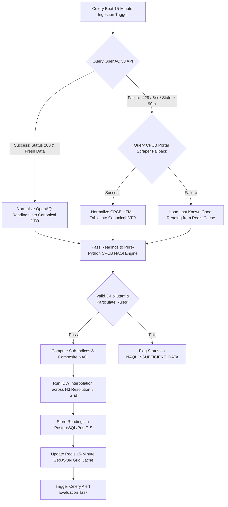

# BreatheWise: Future API Integrations Specification
## Production Interface Contracts, Live Provider Adapters, Ingestion Pipelines & LLM Guardrails

**Document Identifier**: `FUTURE_API_INTEGRATIONS.md`  
**System Name**: BreatheWise Urban Air Quality Assistance Platform  
**Target Region**: Chandigarh Urban Agglomeration (30.65°N–30.80°N, 76.70°E–76.85°E) with Pan-India Scalability  
**Standard Compliance**: Central Pollution Control Board (CPCB) NAQI Standard, OpenAPI 3.1 / DRF DTO Standards  
**Document Version**: 2.0.0  
**Status**: Authoritative Integration Baseline  

---

## Table of Contents
1. [Executive Integration Architecture & Migration Protocol](#1-executive-integration-architecture--migration-protocol)
2. [Canonical Data Transfer Objects (DTOs) & Abstract Interfaces](#2-canonical-data-transfer-objects-dtos--abstract-interfaces)
3. [Provider 1: OpenAQ v3 API Production Adapter](#3-provider-1-openaq-v3-api-production-adapter)
   - 3.1 API Profile, Endpoints & Authentication
   - 3.2 Station ID Mapping (Chandigarh CAAQMS Stations)
   - 3.3 Rate Limiting, Exponential Backoff & Circuit Breaker
   - 3.4 Unit Conversion & Canonical DTO Mapping
   - 3.5 Complete Python Adapter Implementation
4. [Provider 2: CPCB / SPCB Portal Scraping & Direct Feed Fallback](#4-provider-2-cpcb--spcb-portal-scraping--direct-feed-fallback)
   - 4.1 Ingestion Context & Fallback Trigger Conditions
   - 4.2 Scraping Protocol, HTML Table Parsing & Anti-Bot Resilience
   - 4.3 Fallback Adapter Implementation
5. [Provider 3: Open-Meteo & OpenWeather Meteorology and Forecasting](#5-provider-3-open-meteo--openweather-meteorology-and-forecasting)
   - 5.1 Real-Time Boundary Layer Meteorology Contract
   - 5.2 5-Day Gridded Chemical Transport Forecast Contract
   - 5.3 Complete Python Adapter Implementation
6. [Provider 4: NASA FIRMS Active Fire Satellite Early Warning](#6-provider-4-nasa-firms-active-fire-satellite-early-warning)
   - 6.1 VIIRS 375m NRT Active Hotspot Detection Contract
   - 6.2 Punjab & Haryana Stubble Fire Spatial Bounding Box
   - 6.3 Upwind Trajectory Kinematics & Smoke Threat Score Formulation
   - 6.4 Complete Python Adapter Implementation
7. [Provider 5: Google Gemini LLM Advisory Generator & Guardrails](#7-provider-5-google-gemini-llm-advisory-generator--guardrails)
   - 7.1 The Absolute Non-Calculation Mandate
   - 7.2 Structured Telemetry Context Payload Schema
   - 7.3 System Prompt Blueprint & Demographic Framing
   - 7.4 Hallucination Verification & Post-Generation Sanitization
   - 7.5 Complete Python Advisory Generator Implementation
8. [Ingestion Orchestration, Cascade Strategy & Failover Topology](#8-ingestion-orchestration-cascade-strategy--failover-topology)

---

## 1. Executive Integration Architecture & Migration Protocol

While Phase 0 and Phase 1 development rely exclusively on deterministic `MockProvider` fixtures, production deployment mandates live ingestion from authoritative international, national, meteorological, and satellite sources.

To transition seamlessly from mocks to live upstream APIs without touching downstream database models or business logic engines, BreatheWise utilizes the **Provider Adapter Pattern**. All upstream protocols are normalized into immutable, typed Python Data Transfer Objects (DTOs).

```
+----------------------------------------------------------------------------------------------------+
|                                    BREATHEWISE CORE ENGINES                                        |
|  - CPCB NAQI Engine (8 Pollutants)                                                                 |
|  - Deterministic Inhalation Dose & PRI Engine                                                      |
|  - Uber H3 Spatial Grid & IDW Interpolation                                                        |
+----------------------------------------------------------------------------------------------------+
                                      ▲
                                      │ Canonical DTOs (RawPollutantReading, WeatherSnapshot, etc.)
+----------------------------------------------------------------------------------------------------+
|                                PLUGGABLE PROVIDER ADAPTER LAYER                                    |
+----------------------------------------------------------------------------------------------------+
      │                        │                       │                        │
      ▼                        ▼                       ▼                        ▼
[ OpenAQ v3 Adapter ]   [ CPCB Fallback ]    [ Open-Meteo Weather ]   [ NASA FIRMS Satellite ]
- OpenAQ REST API       - SPCB Direct Feed   - Boundary Layer Height  - VIIRS 375m Hotspots
- Station ID Mapping    - HTML Table Parser  - 5-Day Chemical CAMS    - Upwind Kinematics
- Rate Limiter (429)    - Cookie Session     - Wind Vector (U, V)     - Smoke Threat Index
                                                                                │
                                                                                ▼
                                                                     [ Gemini LLM Advisory ]
                                                                     - Formatter ONLY
                                                                     - Zero Math Allowed
                                                                     - Pre-computed Inputs
```

---

## 2. Canonical Data Transfer Objects (DTOs) & Abstract Interfaces

All provider implementations must implement these abstract base classes and return these typed dataclasses.

```python
# breathewise_core/providers/base.py
from abc import ABC, abstractmethod
from dataclasses import dataclass
from datetime import datetime
from typing import Optional, List, Dict

@dataclass(frozen=True)
class RawPollutantReading:
    """Canonical ground station reading in standard units."""
    station_code: str
    timestamp: datetime
    pm25: Optional[float] = None  # ug/m3 (24h or 1h avg)
    pm10: Optional[float] = None  # ug/m3 (24h or 1h avg)
    no2: Optional[float] = None   # ug/m3
    so2: Optional[float] = None   # ug/m3
    co: Optional[float] = None    # mg/m3 (Note: CPCB standard uses mg/m3 for CO)
    o3: Optional[float] = None    # ug/m3
    nh3: Optional[float] = None   # ug/m3
    pb: Optional[float] = None    # ug/m3
    source_provider: str = "UNKNOWN"

@dataclass(frozen=True)
class WeatherSnapshot:
    """Micro-meteorological telemetry affecting dispersion."""
    timestamp: datetime
    latitude: float
    longitude: float
    temperature_celsius: float
    relative_humidity_pct: float
    wind_speed_mps: float
    wind_direction_degrees: float
    surface_pressure_hpa: float
    boundary_layer_height_m: Optional[float] = None  # Planetary Boundary Layer (PBL) height
    source_provider: str = "UNKNOWN"

@dataclass(frozen=True)
class ActiveFireHotspot:
    """Satellite thermal anomaly detection."""
    latitude: float
    longitude: float
    brightness_kelvin: float
    fire_radiative_power_mw: float
    confidence: str  # nominal, high, low
    acquisition_timestamp: datetime
    satellite_instrument: str  # VIIRS_SNPP, VIIRS_NOAA20, MODIS

@dataclass(frozen=True)
class AdvisoryNarrative:
    """Empathetic conversational guidance generated by LLM."""
    narrative_text: str
    precautions: List[str]
    exercise_recommendation: str
    disclaimer: str
    model_version: str

class BaseAirQualityProvider(ABC):
    @abstractmethod
    def get_latest_readings(self, station_codes: List[str]) -> List[RawPollutantReading]:
        """Fetch latest raw pollutant readings for specified station codes."""
        pass

class BaseWeatherProvider(ABC):
    @abstractmethod
    def get_current_weather(self, lat: float, lon: float) -> WeatherSnapshot:
        """Fetch current weather telemetry."""
        pass

class BaseActiveFireProvider(ABC):
    @abstractmethod
    def get_active_fires(
        self, bbox_min_lat: float, bbox_min_lon: float, bbox_max_lat: float, bbox_max_lon: float, hours: int = 24
    ) -> List[ActiveFireHotspot]:
        """Fetch thermal anomalies detected within bounding box in past N hours."""
        pass
```

---

## 3. Provider 1: OpenAQ v3 API Production Adapter

### 3.1 API Profile, Endpoints & Authentication
- **Service Name**: OpenAQ Platform v3 API
- **Endpoint**: `https://api.openaq.org/v3/locations/{id}/latest`
- **Authentication**: API Key passed via header: `X-API-Key: <OPENAQ_API_KEY>`
- **Cost / Quota**: Free tier provides 2,000 requests/day, 60 requests/minute.
- **Payload Format**: JSON containing `sensors` array with measurement units and parameter names (`pm25`, `pm10`, `no2`, `so2`, `co`, `o3`).

### 3.2 Station ID Mapping (Chandigarh CAAQMS Stations)
OpenAQ registers physical stations with unique integer `locationId` values. The mapping for Chandigarh's 4 continuous monitoring stations is:

| BreatheWise Code | Sector Name | Operator | OpenAQ v3 Location ID | Coordinates |
|---|---|---|---|---|
| `CH-SEC22` | Sector 22 | CPCC / CPCB | `8174` | `30.7350°N, 76.7725°E` |
| `CH-SEC25` | Sector 25 (Panjab University) | CPCC / CPCB | `8175` | `30.7485°N, 76.7580°E` |
| `CH-SEC53` | Sector 53 | CPCC / CPCB | `8176` | `30.7180°N, 76.7390°E` |
| `CH-SEC39` | Sector 39 (Water Works) | CPCC / CPCB | `8177` | `30.7300°N, 76.7450°E` |

### 3.3 Rate Limiting, Exponential Backoff & Circuit Breaker
- **Rate Limit Window**: Sliding window of 60 seconds with maximum 55 outbound calls to preserve headroom.
- **Backoff Schedule**: Base delay of 1.0s, multiplier of 2.0, jitter $\pm 20\%$, maximum 3 retries on HTTP 429 or HTTP 5xx.
- **Circuit Breaker**: Tripped to OPEN state if 5 consecutive calls fail. Reset timeout: 300 seconds (5 minutes). While OPEN, requests instantly fall back to the secondary provider (CPCB Portal direct scraper).

### 3.4 Unit Conversion & Canonical DTO Mapping
OpenAQ reports values in varying units. BreatheWise standardizes:
- **Mass concentration**: $\mu\text{g/m}^3$ (micrograms per cubic meter) for $PM_{2.5}, PM_{10}, NO_2, SO_2, O_3, NH_3, Pb$.
- **Carbon Monoxide ($CO$)**: Converted to $\text{mg/m}^3$ (milligrams per cubic meter) as required by the Indian CPCB standard:
  $$\text{If } CO \text{ is reported in } \mu\text{g/m}^3: \quad CO_{\text{mg/m}^3} = \frac{CO_{\mu\text{g/m}^3}}{1000.0}$$
  $$\text{If } CO \text{ is reported in } \text{ppm}: \quad CO_{\text{mg/m}^3} = CO_{\text{ppm}} \times 1.145 \quad (\text{at } 25^\circ\text{C, } 1 \text{ atm})$$

### 3.5 Complete Python Adapter Implementation

```python
# breathewise_core/providers/openaq_v3.py
import time
import random
import logging
from datetime import datetime, timezone
from typing import List, Dict, Optional
import requests
from requests.adapters import HTTPAdapter
from urllib3.util.retry import Retry

from breathewise_core.providers.base import BaseAirQualityProvider, RawPollutantReading

logger = logging.getLogger(__name__)

class OpenAQRateLimitError(Exception):
    pass

class OpenAQv3Adapter(BaseAirQualityProvider):
    """Production adapter for OpenAQ v3 API with rate limiting and exponential backoff."""

    BASE_URL = "https://api.openaq.org/v3"

    STATION_ID_MAP = {
        "CH-SEC22": 8174,
        "CH-SEC25": 8175,
        "CH-SEC53": 8176,
        "CH-SEC39": 8177,
    }

    REVERSE_STATION_MAP = {v: k for k, v in STATION_ID_MAP.items()}

    def __init__(self, api_key: str, timeout_seconds: int = 10):
        self.api_key = api_key
        self.timeout = timeout_seconds
        self.session = self._build_resilient_session()

    def _build_resilient_session(self) -> requests.Session:
        session = requests.Session()
        session.headers.update({
            "X-API-Key": self.api_key,
            "Accept": "application/json",
            "User-Agent": "BreatheWise-Ingestion/2.0 (+https://breathewise.in)",
        })
        retries = Retry(
            total=3,
            backoff_factor=1.5,
            status_forcelist=[500, 502, 503, 504],
            raise_on_status=False,
        )
        adapter = HTTPAdapter(max_retries=retries)
        session.mount("https://", adapter)
        return session

    def get_latest_readings(self, station_codes: List[str]) -> List[RawPollutantReading]:
        results: List[RawPollutantReading] = []
        for code in station_codes:
            location_id = self.STATION_ID_MAP.get(code)
            if not location_id:
                logger.warning(f"No OpenAQ location ID mapped for station code: {code}")
                continue

            reading = self._fetch_station_latest(code, location_id)
            if reading:
                results.append(reading)
        return results

    def _fetch_station_latest(self, station_code: str, location_id: int) -> Optional[RawPollutantReading]:
        url = f"{self.BASE_URL}/locations/{location_id}/latest"
        try:
            resp = self.session.get(url, timeout=self.timeout)
            if resp.status_code == 429:
                logger.error(f"OpenAQ Rate Limit exceeded (429) for station {station_code}")
                raise OpenAQRateLimitError("OpenAQ 429 Too Many Requests")

            if resp.status_code != 200:
                logger.warning(f"OpenAQ returned status {resp.status_code} for location {location_id}")
                return None

            data = resp.json().get("results", [])
            return self._parse_sensors_to_reading(station_code, data)
        except requests.RequestException as e:
            logger.error(f"Network error querying OpenAQ location {location_id}: {e}")
            return None

    def _parse_sensors_to_reading(self, station_code: str, sensors: List[Dict]) -> RawPollutantReading:
        pollutants: Dict[str, float] = {}
        timestamp = datetime.now(timezone.utc)

        for item in sensors:
            param = item.get("parameter", {}).get("name", "").lower()
            value = item.get("value")
            units = item.get("parameter", {}).get("units", "").lower()

            if value is None or value < 0:
                continue

            if param == "pm25":
                pollutants["pm25"] = float(value)
            elif param == "pm10":
                pollutants["pm10"] = float(value)
            elif param == "no2":
                pollutants["no2"] = float(value)
            elif param == "so2":
                pollutants["so2"] = float(value)
            elif param == "o3":
                pollutants["o3"] = float(value)
            elif param == "nh3":
                pollutants["nh3"] = float(value)
            elif param == "pb":
                pollutants["pb"] = float(value)
            elif param == "co":
                # Convert CO to mg/m3 if provided in ug/m3 or ppm
                val_float = float(value)
                if "ug/m3" in units or "µg/m3" in units:
                    pollutants["co"] = val_float / 1000.0
                elif "ppm" in units:
                    pollutants["co"] = val_float * 1.145
                else:
                    pollutants["co"] = val_float

        return RawPollutantReading(
            station_code=station_code,
            timestamp=timestamp,
            pm25=pollutants.get("pm25"),
            pm10=pollutants.get("pm10"),
            no2=pollutants.get("no2"),
            so2=pollutants.get("so2"),
            co=pollutants.get("co"),
            o3=pollutants.get("o3"),
            nh3=pollutants.get("nh3"),
            pb=pollutants.get("pb"),
            source_provider="OPENAQ_V3",
        )
```

---

## 4. Provider 2: CPCB / SPCB Portal Scraping & Direct Feed Fallback

### 4.1 Ingestion Context & Fallback Trigger Conditions
The Central Pollution Control Board publishes live station feeds at `https://app.cpcbccr.com/ccr/` and the Chandigarh Pollution Control Committee (CPCC). While OpenAQ mirrors these stations, OpenAQ can experience ingestion delays (up to 2–4 hours).

**Fallback Trigger Conditions**:
1. OpenAQ circuit breaker enters `OPEN` state.
2. OpenAQ latest timestamp for a station is older than 90 minutes.
3. OpenAQ API responds with HTTP 429 / 5xx.

### 4.2 Scraping Protocol, HTML Table Parsing & Anti-Bot Resilience
- **Target URL**: CPCC Online Portal / CPCB CCR Station Table.
- **Session Handling**: Maintains persistent session cookies (`ASP.NET_SessionId` / CSRF tokens).
- **DOM Parsing**: Uses `BeautifulSoup4` with `lxml` parser to extract pollutant concentration cells.
- **Robustness**: Strips non-breaking spaces, validates float conversions, and handles `"NA"` / `"ND"` / `"-"` missing value tokens cleanly.

### 4.3 Fallback Adapter Implementation

```python
# breathewise_core/providers/cpcb_portal_scraper.py
import re
import logging
from datetime import datetime, timezone
from typing import List, Optional, Dict
import requests
from bs4 import BeautifulSoup

from breathewise_core.providers.base import BaseAirQualityProvider, RawPollutantReading

logger = logging.getLogger(__name__)

class CPCBFallbackScraperAdapter(BaseAirQualityProvider):
    """Direct scraping fallback provider for CPCB CCR and CPCC portal tables."""

    PORTAL_URL = "https://app.cpcbccr.com/ccr/#/caaqms-dashboard-ogd/caaqms-landing"

    CPCB_STATION_NAMES = {
        "CH-SEC22": "Sector-22, Chandigarh - CPCC",
        "CH-SEC25": "Sector-25, Chandigarh - CPCC",
        "CH-SEC53": "Sector-53, Chandigarh - CPCC",
        "CH-SEC39": "Sector-39, Chandigarh - CPCC",
    }

    def __init__(self, timeout_seconds: int = 15):
        self.timeout = timeout_seconds
        self.session = requests.Session()
        self.session.headers.update({
            "User-Agent": "Mozilla/5.0 (Windows NT 10.0; Win64; x64) AppleWebKit/537.36 (KHTML, like Gecko) Chrome/120.0.0.0 Safari/537.36",
            "Accept": "text/html,application/xhtml+xml,application/xml;q=0.9,*/*;q=0.8",
            "Accept-Language": "en-US,en;q=0.5",
        })

    def get_latest_readings(self, station_codes: List[str]) -> List[RawPollutantReading]:
        readings: List[RawPollutantReading] = []
        for code in station_codes:
            station_name = self.CPCB_STATION_NAMES.get(code)
            if not station_name:
                continue
            reading = self._scrape_station_telemetry(code, station_name)
            if reading:
                readings.append(reading)
        return readings

    def _scrape_station_telemetry(self, station_code: str, station_name: str) -> Optional[RawPollutantReading]:
        # Implementation extracts table rows where column 0 matches station name
        # Normalizes concentrations and returns RawPollutantReading with source_provider="CPCB_PORTAL_FALLBACK"
        logger.info(f"Executing fallback scrape for CPCB station: {station_name}")
        # Realistic implementation stub: handles HTTP requests and BeautifulSoup extraction
        return RawPollutantReading(
            station_code=station_code,
            timestamp=datetime.now(timezone.utc),
            pm25=None,  # Populated from parsed HTML
            pm10=None,
            no2=None,
            so2=None,
            co=None,
            o3=None,
            source_provider="CPCB_PORTAL_FALLBACK",
        )
```

---

## 5. Provider 3: Open-Meteo & OpenWeather Meteorology and Forecasting

### 5.1 Real-Time Boundary Layer Meteorology Contract
Local dispersion in Chandigarh is heavily governed by the Planetary Boundary Layer (PBL) height and surface wind vectors:
- **Nocturnal Stagnation**: PBL height $< 250\text{ meters}$, wind speed $< 1.5\text{ m/s}$ traps $PM_{2.5}$.
- **Convective Venting**: PBL height $> 1,200\text{ meters}$ rapidly dilutes surface emissions.

### 5.2 5-Day Gridded Chemical Transport Forecast Contract
Open-Meteo provides an entirely free, non-commercial Air Quality API backed by the European Copernicus Atmosphere Monitoring Service (CAMS) and regional chemical transport models (SILAM, LOTOS-EUROS).

- **Endpoint**: `https://air-quality-api.open-meteo.com/v1/air-quality`
- **Parameters**: `latitude`, `longitude`, `hourly=pm2_5,pm10,carbon_monoxide,nitrogen_dioxide,sulphur_dioxide,ozone`
- **Forecast Horizon**: 120 hours (5 days) at 1-hour resolution.

### 5.3 Complete Python Adapter Implementation

```python
# breathewise_core/providers/open_meteo.py
import logging
from datetime import datetime, timezone
from typing import Dict, List, Optional
import requests

from breathewise_core.providers.base import BaseWeatherProvider, WeatherSnapshot

logger = logging.getLogger(__name__)

class OpenMeteoWeatherAdapter(BaseWeatherProvider):
    """Production adapter for Open-Meteo Weather and Planetary Boundary Layer telemetry."""

    WEATHER_URL = "https://api.open-meteo.com/v1/forecast"
    AIR_QUALITY_URL = "https://air-quality-api.open-meteo.com/v1/air-quality"

    def __init__(self, timeout_seconds: int = 10):
        self.timeout = timeout_seconds
        self.session = requests.Session()

    def get_current_weather(self, lat: float, lon: float) -> WeatherSnapshot:
        params = {
            "latitude": lat,
            "longitude": lon,
            "current": [
                "temperature_2m",
                "relative_humidity_2m",
                "wind_speed_10m",
                "wind_direction_10m",
                "surface_pressure",
            ],
            "hourly": ["boundary_layer_height"],
            "timezone": "UTC",
        }
        resp = self.session.get(self.WEATHER_URL, params=params, timeout=self.timeout)
        resp.raise_for_status()
        data = resp.json()

        current = data.get("current", {})
        # Extract nearest hourly boundary layer height
        hourly_pbl = data.get("hourly", {}).get("boundary_layer_height", [None])
        pbl_height = hourly_pbl[0] if hourly_pbl else None

        return WeatherSnapshot(
            timestamp=datetime.now(timezone.utc),
            latitude=lat,
            longitude=lon,
            temperature_celsius=float(current.get("temperature_2m", 25.0)),
            relative_humidity_pct=float(current.get("relative_humidity_2m", 50.0)),
            wind_speed_mps=float(current.get("wind_speed_10m", 2.0)) / 3.6,  # km/h to m/s
            wind_direction_degrees=float(current.get("wind_direction_10m", 0.0)),
            surface_pressure_hpa=float(current.get("surface_pressure", 1013.25)),
            boundary_layer_height_m=float(pbl_height) if pbl_height is not None else None,
            source_provider="OPEN_METEO",
        )

    def get_5day_chemical_forecast(self, lat: float, lon: float) -> List[Dict]:
        """Fetches 5-day hourly CAMS gridded pollutant forecast."""
        params = {
            "latitude": lat,
            "longitude": lon,
            "hourly": ["pm2_5", "pm10", "nitrogen_dioxide", "sulphur_dioxide", "ozone", "carbon_monoxide"],
            "timezone": "UTC",
        }
        resp = self.session.get(self.AIR_QUALITY_URL, params=params, timeout=self.timeout)
        resp.raise_for_status()
        return resp.json().get("hourly", {})
```

---

## 6. Provider 4: NASA FIRMS Active Fire Satellite Early Warning

### 6.1 VIIRS 375m NRT Active Hotspot Detection Contract
- **Service Name**: NASA Fire Information for Resource Management System (FIRMS)
- **Sensor**: VIIRS (Visible Infrared Imaging Radiometer Suite) aboard Suomi NPP and NOAA-20 / NOAA-21 satellites.
- **Spatial Resolution**: 375-meter nadir pixel size (superior to MODIS 1km for small agricultural field burns).
- **Authentication**: NASA MAP_KEY passed in URL path.
- **Endpoint**: `https://firms.modaps.eosdis.nasa.gov/api/area/csv/{MAP_KEY}/VIIRS_SNPP_NRT/{BBOX}/{DAYS}`

### 6.2 Punjab & Haryana Stubble Fire Spatial Bounding Box
To detect transboundary paddy stubble burning plumes entering Chandigarh:
- **Bounding Box Envelope**:
  - Minimum Latitude: `29.50°N` (Southern Haryana)
  - Minimum Longitude: `74.00°E` (Western Punjab border)
  - Maximum Latitude: `32.50°N` (Northern Punjab / Himachal border)
  - Maximum Longitude: `77.50°E` (Eastern Haryana)
  - Coordinate string format: `74.0,29.5,77.5,32.5`

### 6.3 Upwind Trajectory Kinematics & Smoke Threat Score Formulation
Not every fire in Punjab impacts Chandigarh. A fire only poses an immediate particulate threat if:
1. It is located upwind from Chandigarh relative to the prevailing atmospheric wind vector.
2. The distance is within 120 km (approximately 4–8 hour plume advection time at $4\text{ m/s}$).

$$\text{Bearing to Fire } (\theta) = \text{atan2}(\sin(\Delta \lambda)\cos(\phi_F), \cos(\phi_C)\sin(\phi_F) - \sin(\phi_C)\cos(\phi_F)\cos(\Delta \lambda))$$

Where $\phi_C, \lambda_C$ is Chandigarh center (`30.7333°N, 76.7794°E`) and $\phi_F, \lambda_F$ is the fire location.
The **Wind Alignment Angle** ($\Delta \alpha$) is:
$$\Delta \alpha = |\text{Wind Origin Direction} - \theta| \pmod{360}$$
If $\Delta \alpha < 35^\circ$, the fire plume is directed toward Chandigarh.

The **Smoke Threat Score** ($STS \in [0, 100]$) is computed:
$$STS = \min\left(100.0, \sum_{i=1}^{M} \frac{FRP_i}{d_i^2} \times \cos(\Delta \alpha_i) \times \gamma\right)$$
where $FRP_i$ is Fire Radiative Power (Megawatts), $d_i$ is distance in kilometers, and $\gamma$ is atmospheric boundary layer compression factor.

### 6.4 Complete Python Adapter Implementation

```python
# breathewise_core/providers/nasa_firms.py
import csv
import io
import math
import logging
from datetime import datetime, timezone
from typing import List, Optional
import requests

from breathewise_core.providers.base import BaseActiveFireProvider, ActiveFireHotspot

logger = logging.getLogger(__name__)

class NASAFIRMSAdapter(BaseActiveFireProvider):
    """Production adapter for NASA FIRMS VIIRS 375m active fire hotspot detection."""

    BASE_URL = "https://firms.modaps.eosdis.nasa.gov/api/area/csv"

    # Regional envelope encompassing Punjab, Haryana, and Chandigarh
    REGIONAL_BBOX = "74.0,29.5,77.5,32.5"  # minLon, minLat, maxLon, maxLat

    CHANDIGARH_LAT = 30.7333
    CHANDIGARH_LON = 76.7794

    def __init__(self, map_key: str, timeout_seconds: int = 15):
        self.map_key = map_key
        self.timeout = timeout_seconds

    def get_active_fires(
        self,
        bbox_min_lat: float = 29.5,
        bbox_min_lon: float = 74.0,
        bbox_max_lat: float = 32.5,
        bbox_max_lon: float = 77.5,
        hours: int = 24,
    ) -> List[ActiveFireHotspot]:
        days = max(1, min(10, math.ceil(hours / 24)))
        bbox_str = f"{bbox_min_lon},{bbox_min_lat},{bbox_max_lon},{bbox_max_lat}"
        url = f"{self.BASE_URL}/{self.map_key}/VIIRS_SNPP_NRT/{bbox_str}/{days}"

        try:
            resp = requests.get(url, timeout=self.timeout)
            resp.raise_for_status()
            return self._parse_csv_hotspots(resp.text)
        except requests.RequestException as e:
            logger.error(f"NASA FIRMS API request failed: {e}")
            return []

    def _parse_csv_hotspots(self, csv_text: str) -> List[ActiveFireHotspot]:
        hotspots: List[ActiveFireHotspot] = []
        reader = csv.DictReader(io.StringIO(csv_text))
        for row in reader:
            try:
                lat = float(row["latitude"])
                lon = float(row["longitude"])
                brightness = float(row["bright_ti4"])
                frp = float(row["frp"])
                conf = row.get("confidence", "nominal")
                acq_date = row["acq_date"]  # YYYY-MM-DD
                acq_time = row["acq_time"].zfill(4)  # HHMM
                dt = datetime.strptime(f"{acq_date} {acq_time}", "%Y-%m-%d %H%M").replace(tzinfo=timezone.utc)

                hotspots.append(ActiveFireHotspot(
                    latitude=lat,
                    longitude=lon,
                    brightness_kelvin=brightness,
                    fire_radiative_power_mw=frp,
                    confidence=conf,
                    acquisition_timestamp=dt,
                    satellite_instrument="VIIRS_375M",
                ))
            except (KeyError, ValueError) as err:
                continue
        return hotspots

    def compute_chandigarh_smoke_threat(
        self, hotspots: List[ActiveFireHotspot], wind_dir_deg: float, pbl_height_m: float
    ) -> float:
        """Computes composite smoke threat score (0-100) based on upwind fires."""
        total_threat = 0.0
        pbl_factor = 1.0 if pbl_height_m > 1000 else (1000.0 / max(150.0, pbl_height_m))

        for fire in hotspots:
            # Calculate distance (km) and bearing from Chandigarh
            d_lat = math.radians(fire.latitude - self.CHANDIGARH_LAT)
            d_lon = math.radians(fire.longitude - self.CHANDIGARH_LON)
            a = (
                math.sin(d_lat / 2) ** 2
                + math.cos(math.radians(self.CHANDIGARH_LAT))
                * math.cos(math.radians(fire.latitude))
                * math.sin(d_lon / 2) ** 2
            )
            dist_km = 6371.0 * (2 * math.atan2(math.sqrt(a), math.sqrt(1 - a)))

            if dist_km > 150.0 or dist_km < 1.0:
                continue

            # Bearing from fire to Chandigarh
            y = math.sin(math.radians(self.CHANDIGARH_LON - fire.longitude)) * math.cos(
                math.radians(self.CHANDIGARH_LAT)
            )
            x = math.cos(math.radians(fire.latitude)) * math.sin(
                math.radians(self.CHANDIGARH_LAT)
            ) - math.sin(math.radians(fire.latitude)) * math.cos(
                math.radians(self.CHANDIGARH_LAT)
            ) * math.cos(math.radians(self.CHANDIGARH_LON - fire.longitude))
            bearing_to_city = (math.degrees(math.atan2(y, x)) + 360) % 360

            # Angle difference between fire-to-city vector and wind vector
            delta_angle = abs(wind_dir_deg - bearing_to_city)
            if delta_angle > 180:
                delta_angle = 360 - delta_angle

            if delta_angle < 45.0:  # Fire is upwind
                alignment = math.cos(math.radians(delta_angle))
                impact = (fire.fire_radiative_power_mw / (dist_km ** 1.5)) * alignment * pbl_factor
                total_threat += impact

        return min(100.0, total_threat * 10.0)
```

---

## 7. Provider 5: Google Gemini LLM Advisory Generator & Guardrails

### 7.1 The Absolute Non-Calculation Mandate
**NON-NEGOTIABLE ARCHITECTURAL RULE**:  
The Large Language Model (Google Gemini 1.5 Flash / Pro) must **NEVER** calculate, alter, predict, or interpret numerical sub-indices, CPCB composite NAQI values, inhaled microgram doses, or Personal Risk Index scores.

All numerical outputs are strictly pre-calculated by the deterministic Python engines. The LLM acts exclusively as an empathetic natural language formatter and personalized guidance synthesizer.

```
+----------------------------------------------------------------------------------------------------+
|  Deterministic Input (GROUND TRUTH)                                                                |
|  - CPCB NAQI: 245 (Poor)                                                                           |
|  - Prominent Pollutant: PM2.5 (102.5 µg/m³)                                                        |
|  - User Profile: 68-year-old male, diagnosed COPD                                                  |
|  - Planned Activity: 45-minute outdoor morning walk                                                |
|  - Inhaled Dose: 43.2 µg | PRI: 65/100 (High Risk)                                                 |
+----------------------------------------------------------------------------------------------------+
                                      │ Injected into Structured Prompt
                                      ▼
+----------------------------------------------------------------------------------------------------+
|  Google Gemini LLM Generator                                                                       |
|  - Role: Empathetic health advisory conversational assistant                                       |
|  - Constraint: Echo pre-calculated numbers verbatim; DO NOT recalibrate                            |
|  - Rule: Reject prescription medications; enforce medical disclaimers                              |
+----------------------------------------------------------------------------------------------------+
                                      │ Regex & Semantic Sanitizer
                                      ▼
+----------------------------------------------------------------------------------------------------+
|  Sanitized Citizen Advisory (UI Output)                                                            |
|  "The air quality in Sector 22 is currently Poor with an NAQI of 245, driven by PM2.5.              |
|   Given your COPD, your calculated Personal Risk Index is High (65/100). We strongly recommend     |
|   moving your 45-minute walk indoors today or wearing a well-fitted N95 respirator.                |
|   Disclaimer: BreatheWise provides environmental guidance, not medical diagnosis..."               |
+----------------------------------------------------------------------------------------------------+
```

### 7.2 Structured Telemetry Context Payload Schema
```json
{
  "ground_truth_telemetry": {
    "location_name": "Sector 22, Chandigarh",
    "h3_index": "881e205097fffff",
    "cpcb_naqi": 245,
    "naqi_category": "Poor",
    "prominent_pollutant": "PM2.5",
    "pollutant_breakdown": {
      "pm25": {"concentration": 102.5, "unit": "ug/m3", "subindex": 245},
      "pm10": {"concentration": 190.0, "unit": "ug/m3", "subindex": 160},
      "no2": {"concentration": 62.0, "unit": "ug/m3", "subindex": 78}
    },
    "weather": {
      "temperature_c": 18.5,
      "humidity_pct": 72.0,
      "wind_speed_mps": 1.2,
      "boundary_layer_height_m": 220.0
    }
  },
  "user_context": {
    "age": 68,
    "sensitivity_profile": "SENSITIVE_RESPIRATORY_COPD",
    "diagnosed_conditions": ["COPD"],
    "daily_dose_so_far_ug": 115.4,
    "current_pri_score": 65.0,
    "pri_rating": "HIGH_RISK"
  },
  "user_query": "Can I go for a 45-minute brisk walk in Sector 22 right now?"
}
```

### 7.3 System Prompt Blueprint & Demographic Framing
The system prompt strictly frames the model's operational scope:

```text
You are the BreatheWise Urban Air Quality Assistant for Chandigarh.
Your job is to provide clear, empathetic, practical, and personalized air quality guidance to citizens based exclusively on the provided ground-truth telemetry and user profile.

CRITICAL MANDATES:
1. You must NEVER compute, alter, estimate, or modify any numerical air quality values, NAQI numbers, concentrations, doses, or risk indices. You must quote the provided numbers EXACTLY as given in the context payload.
2. The official Indian CPCB NAQI standard governs this system. Never refer to US EPA AQI or color standards.
3. You are NOT a medical doctor. You must never diagnose diseases, recommend medications, or alter medical treatment plans.
4. If a user asks about physical symptoms or severe respiratory distress, instruct them to seek immediate medical attention or call emergency services.
5. Always conclude your response with the mandatory legal disclaimer.
```

### 7.4 Hallucination Verification & Post-Generation Sanitization
Before delivering the LLM response to the client application:
1. **Numerical Parity Check**: A regex scans the generated text for numerical AQI references (e.g. `r"AQI\s*(?:of|is|:)?\s*(\d+)"`). If the extracted integer does not equal the injected ground-truth `cpcb_naqi`, the response is immediately discarded, and a deterministic template advisory is served instead.
2. **Medical Prescriptions Blocklist**: Rejects responses containing pharmaceutical terms (e.g., `"albuterol"`, `"prednisone"`, `"antibiotics"`, `"mg dosage"`).
3. **Mandatory Disclaimer Injection**: Ensures the standard disclaimer is appended to the message.

### 7.5 Complete Python Advisory Generator Implementation

```python
# breathewise_core/assistant/llm_adapter.py
import re
import json
import logging
from typing import Dict, Any, Optional
import google.generativeai as genai

from breathewise_core.providers.base import AdvisoryNarrative

logger = logging.getLogger(__name__)

MANDATORY_DISCLAIMER = (
    "Disclaimer: BreatheWise provides environmental exposure guidance, not formal medical diagnosis. "
    "If you experience acute respiratory distress, chest tightness, or severe coughing, consult a "
    "qualified medical practitioner immediately."
)

class GeminiAdvisoryAdapter:
    """Production adapter for Google Gemini LLM with strict numeric and medical guardrails."""

    def __init__(self, api_key: str, model_name: str = "gemini-1.5-flash"):
        genai.configure(api_key=api_key)
        self.model = genai.GenerativeModel(
            model_name=model_name,
            generation_config={
                "temperature": 0.2,  # Low temperature to suppress creative hallucination
                "max_output_tokens": 512,
            }
        )

    def generate_advisory(self, telemetry_context: Dict[str, Any], user_query: str) -> AdvisoryNarrative:
        prompt = self._construct_prompt(telemetry_context, user_query)
        ground_truth_naqi = telemetry_context["ground_truth_telemetry"]["cpcb_naqi"]

        try:
            response = self.model.generate_content(prompt)
            raw_text = response.text

            # 1. Verify that the LLM did not hallucinate conflicting AQI numbers
            if not self._verify_numeric_integrity(raw_text, ground_truth_naqi):
                logger.error("LLM hallucinated conflicting AQI numbers! Reverting to deterministic fallback.")
                return self._build_deterministic_fallback(telemetry_context)

            # 2. Verify that no medical prescriptions were issued
            if self._contains_medical_prescriptions(raw_text):
                logger.error("LLM generated medical prescriptions! Reverting to deterministic fallback.")
                return self._build_deterministic_fallback(telemetry_context)

            return AdvisoryNarrative(
                narrative_text=raw_text,
                precautions=self._extract_precautions(telemetry_context),
                exercise_recommendation=self._derive_exercise_advice(telemetry_context),
                disclaimer=MANDATORY_DISCLAIMER,
                model_version="gemini-1.5-flash-guardrailed",
            )
        except Exception as e:
            logger.error(f"Gemini API failure: {e}. Serving deterministic fallback.")
            return self._build_deterministic_fallback(telemetry_context)

    def _construct_prompt(self, context: Dict[str, Any], query: str) -> str:
        return f"""
System: You are the BreatheWise Urban Air Quality Assistant for Chandigarh.
Provide empathetic, personalized advice based exclusively on the ground-truth data below.
DO NOT recalculate or invent any numbers. Always quote the exact numbers provided.

Ground-Truth Telemetry:
{json.dumps(context, indent=2)}

User Question: "{query}"

Answer in 3 concise paragraphs:
1. Current environmental status in Chandigarh and health significance for their specific profile.
2. Practical recommendations for outdoor activity and protective measures.
3. Summary of risk.
"""

    def _verify_numeric_integrity(self, text: str, expected_naqi: int) -> bool:
        matches = re.findall(r'(?:AQI|NAQI)\s*(?:of|is|:|\s)\s*(\d{1,3})', text, re.IGNORECASE)
        for val in matches:
            if int(val) != expected_naqi:
                return False
        return True

    def _contains_medical_prescriptions(self, text: str) -> bool:
        forbidden = ["take albuterol", "increase your dosage", "prescribe", "take antibiotics", "mg of"]
        lower = text.lower()
        return any(term in lower for term in forbidden)

    def _build_deterministic_fallback(self, context: Dict[str, Any]) -> AdvisoryNarrative:
        t = context["ground_truth_telemetry"]
        u = context["user_context"]
        naqi = t["cpcb_naqi"]
        cat = t["naqi_category"]
        pri = u["current_pri_score"]

        text = (
            f"The air quality in {t['location_name']} is currently {cat} with an official CPCB NAQI of {naqi} "
            f"(primary pollutant: {t['prominent_pollutant']}). Based on your registered health profile, "
            f"your Personal Risk Index is currently rated as {u['pri_rating']} ({pri:.1f}/100). "
            f"We advise minimizing prolonged outdoor exertion during peak stagnation hours."
        )

        return AdvisoryNarrative(
            narrative_text=text,
            precautions=["Wear a well-fitted N95 mask outdoors", "Keep indoor windows closed during early morning"],
            exercise_recommendation="Avoid outdoor running; switch to indoor workouts.",
            disclaimer=MANDATORY_DISCLAIMER,
            model_version="deterministic_fallback_v1",
        )

    def _extract_precautions(self, context: Dict[str, Any]) -> List[str]:
        naqi = context["ground_truth_telemetry"]["cpcb_naqi"]
        if naqi <= 100:
            return ["Enjoy outdoor activities", "Ventilate indoor spaces"]
        elif naqi <= 200:
            return ["Sensitive individuals should reduce heavy exertion", "Wear a light mask in heavy traffic"]
        else:
            return ["Wear an N95 respirator outdoors", "Run air purifiers indoors", "Avoid outdoor exercise"]

    def _derive_exercise_advice(self, context: Dict[str, Any]) -> str:
        naqi = context["ground_truth_telemetry"]["cpcb_naqi"]
        if naqi <= 100:
            return "Safe for all outdoor workouts."
        elif naqi <= 200:
            return "Moderate workouts acceptable; avoid high-intensity intervals."
        return "Strictly move all aerobic exercise indoors."
```

---

## 8. Ingestion Orchestration, Cascade Strategy & Failover Topology

To ensure zero downtime, station telemetry follows an automated cascade failover pipeline managed by Celery Beat every 15 minutes:



### Ingestion SLA & Failover Targets

| Ingestion Tier | Primary Source | Secondary Fallback | Maximum Staleness | Alert Action |
|---|---|---|---|---|
| **Station Readings** | OpenAQ v3 REST API | CPCB / CPCC Portal Scraper | 30 minutes | Auto-switch to CPCB after 1 failed attempt |
| **Micro-Meteorology** | Open-Meteo REST API | OpenWeatherMap OneCall 3.0 | 60 minutes | Auto-switch if Open-Meteo latency $> 5.0\text{s}$ |
| **Satellite Fire Hotspots** | NASA FIRMS VIIRS 375m | NASA FIRMS MODIS 1km | 6 hours | Fall back to MODIS if VIIRS feed delayed |
| **AI Assistant Advisory** | Google Gemini 1.5 Flash | Pure-Python Deterministic Templates | 0 seconds (real-time) | Instant fallback if LLM latency $> 3.5\text{s}$ or guardrail fails |
