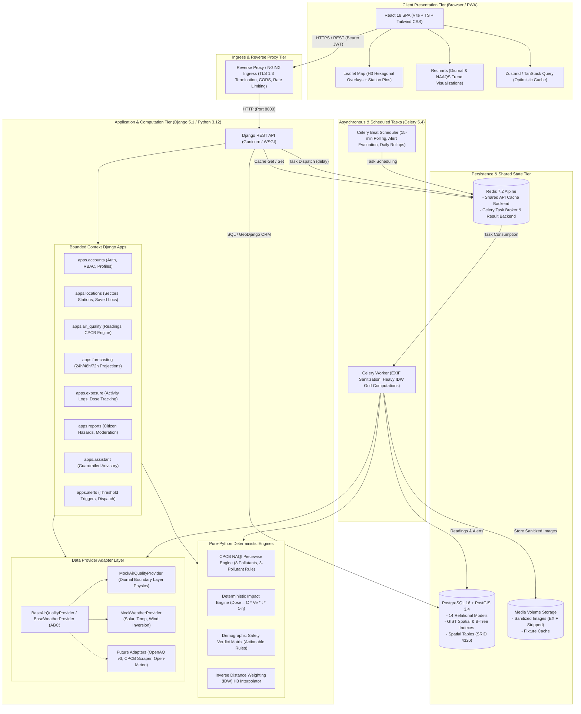
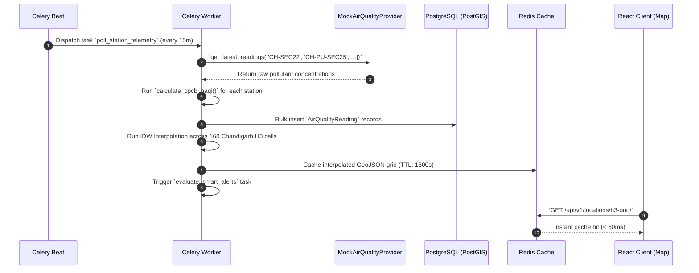
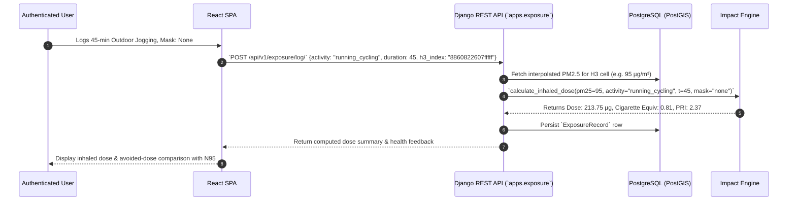
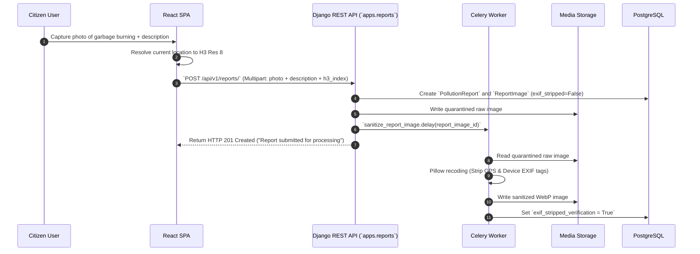

# BreatheWise: System Architecture Specification
## High-Level System Architecture, Service Boundaries, Computational Engines & Spatial Topology

**Document Identifier**: `SYSTEM_ARCHITECTURE.md`  
**System Name**: BreatheWise Urban Air Quality Assistance Platform  
**Target Region**: Chandigarh Urban Agglomeration (30.65°N–30.80°N, 76.70°E–76.85°E)  
**Document Version**: 2.0.0  
**Status**: Authoritative Architectural Baseline  

---

## Table of Contents
1. [Executive Architectural Summary](#1-executive-architectural-summary)
2. [End-to-End System Architecture Diagram](#2-end-to-end-system-architecture-diagram)
3. [6-Service Docker Compose Container Topology](#3-6-service-docker-compose-container-topology)
   - 3.1 Service Boundaries & Network Topology
   - 3.2 Service 1: `frontend` (React Single Page Application)
   - 3.3 Service 2: `web` (Django 5.1 REST API & GeoDjango Engine)
   - 3.4 Service 3: `db` (PostgreSQL 16 with PostGIS 3.4 Spatial Extension)
   - 3.5 Service 4: `redis` (Cache & Celery Message Broker)
   - 3.6 Service 5: `worker` (Celery Asynchronous Computation Worker)
   - 3.7 Service 6: `beat` (Celery Periodic Task Scheduler)
4. [Data Provider Adapter Pattern & Zero-Network Mock Layer](#4-data-provider-adapter-pattern--zero-network-mock-layer)
   - 4.1 Interface Contract Definition (`BaseAirQualityProvider` & `BaseWeatherProvider`)
   - 4.2 Deterministic `MockAirQualityProvider` with Diurnal Boundary Physics
   - 4.3 Deterministic `MockWeatherProvider`
   - 4.4 Chandigarh Station Fixtures (Sector 22, Sector 25, Sector 53, Sector 39)
5. [Pure-Python Deterministic Impact Engine](#5-pure-python-deterministic-impact-engine)
   - 5.1 Mathematical Formulations & Physiological Baselines
   - 5.2 Inhaled Particulate Dose Equation
   - 5.3 Cigarette Equivalence Formulation
   - 5.4 Personal Risk Index ($PRI$) Calculation
   - 5.5 Versioned Configuration Architecture (`impact_config_v1.py`)
6. [Rule-Based Safety Verdict Engine](#6-rule-based-safety-verdict-engine)
   - 6.1 Piecewise Linear CPCB NAQI Interpolation Engine
   - 6.2 The Mandatory 3-Pollutant & Particulate Validation Rule
   - 6.3 Demographic Sensitivity Risk Matrix & Advisory Generator
7. [Spatial Architecture & Privacy by Design](#7-spatial-architecture--privacy-by-design)
   - 7.1 Uber H3 Discrete Global Grid System (Resolution 7 & 8)
   - 7.2 Inverse Distance Weighting (IDW) Spatial Interpolation Engine
   - 7.3 Zero-Raw-GPS Ingestion & Spatial Hashing Pipeline
   - 7.4 Automated Asynchronous EXIF Stripping Pipeline
8. [Data Flow & Integration Sequences](#8-data-flow--integration-sequences)
   - 8.1 15-Minute Telemetry Ingestion & Interpolation Loop
   - 8.2 User Exposure Activity Logging & Physiological Dose Flow
   - 8.3 Citizen Hazard Report Submission & EXIF Sanitization Flow

---

## 1. Executive Architectural Summary

BreatheWise is structured as a decoupled, multi-container distributed system optimized for geospatial intelligence, environmental health calculation, and low-latency decision support. The architecture adheres to five foundational design principles:

1. **Strict Service Decoupling**: The user-facing React Single Page Application (SPA) is completely decoupled from the Django REST API backend, communicating strictly over stateless JSON/REST with Bearer JWT tokens.
2. **Computational Determinism**: All environmental sub-index interpolations, inhaled particulate doses, cigarette equivalencies, and demographic risk verdicts are computed in a pure-Python impact engine with zero floating-point ambiguities or external black-box dependencies.
3. **Provider Isolation**: All third-party atmospheric telemetry is isolated behind a pluggable Adapter Pattern. In Phase 0 and Phase 1, the platform operates entirely on deterministic, time-seeded mock providers that model Chandigarh's physical boundary layer diurnal cycle.
4. **Spatial Partitioning via Uber H3**: Geographic spaces are discretized into hexagonal H3 cells (Resolution 8 for neighborhood sectors, Resolution 7 for macro-urban analysis). This enables high-performance spatial aggregations, eliminates coordinate rounding errors, and natively preserves user privacy.
5. **Zero-Raw-GPS Privacy by Design**: Precise GPS coordinates are fuzzed into H3 cell identifiers immediately upon receipt and never stored in relational tables or log streams. Uploaded citizen hazard photos are stripped of all EXIF metadata before persistence.

---

## 2. End-to-End System Architecture Diagram



---

## 3. 6-Service Docker Compose Container Topology

The platform runtime is orchestrated via a 6-service Docker Compose specification ensuring absolute reproducibility across development, testing, and production environments:

```
┌────────────────────────────────────────────────────────────────────────┐
│                      DOCKER COMPOSE TOPOLOGY (6 SERVICES)              │
│                                                                        │
│   [frontend]     Port 5173 ──► React 18 SPA (Vite / Node 20)           │
│   [web]          Port 8000 ──► Django 5.1 / Python 3.12 REST API       │
│   [db]           Port 5432 ──► PostgreSQL 16 + PostGIS 3.4             │
│   [redis]        Port 6379 ──► Redis 7.2 Alpine (Cache + Broker)       │
│   [worker]       (Internal)──► Celery 5.4 Background Worker             │
│   [beat]         (Internal)──► Celery Beat 5.4 Scheduler               │
└────────────────────────────────────────────────────────────────────────┘
```

### 3.1 Service Boundaries & Network Topology
- **Internal Network**: All backend containers (`web`, `db`, `redis`, `worker`, `beat`) communicate over an isolated Docker bridge network (`breathewise-internal`).
- **External Exposure**: Only the `frontend` (port 5173 in dev) and `web` (port 8000) bind host ports. In production, an NGINX container binds ports 80/443 and routes traffic internally.
- **Persistent Volumes**:
  - `postgres_data`: Persists PostgreSQL 16 cluster data (`/var/lib/postgresql/data`).
  - `redis_data`: Persists Redis snapshots (`/data`).
  - `media_data`: Shared volume between `web` and `worker` for sanitized report images (`/app/media`).
  - `static_data`: Holds collected Django static assets.

### 3.2 Service 1: `frontend` (React Single Page Application)
- **Base Image**: `node:20-alpine` (Development: Vite dev server with Hot Module Replacement; Production: multi-stage build serving static assets via NGINX).
- **Technology Stack**: React 18.3, TypeScript 5.5, Vite 5.4, Tailwind CSS 3.4, Leaflet 1.9, Recharts 2.12, Lucide React, Zustand / TanStack Query.
- **Port Mapping**: `5173:5173` (development).
- **Environment Variables**:
  - `VITE_API_BASE_URL`: Base endpoint URL for the Django REST API (`http://localhost:8000/api/v1`).
  - `VITE_DEFAULT_CITY`: `"Chandigarh"`.
  - `VITE_DEFAULT_LAT`: `30.7333`.
  - `VITE_DEFAULT_LON`: `76.7794`.
  - `VITE_ENABLE_MOCK_DISCLAIMER`: `"true"`.

### 3.3 Service 2: `web` (Django 5.1 REST API & GeoDjango Engine)
- **Base Image**: `python:3.12-slim-bookworm`.
- **System Dependencies**: `gdal-bin`, `libgdal-dev`, `libgeos-dev`, `libproj-dev`, `postgresql-client`.
- **Port Mapping**: `8000:8000`.
- **Command**: `python manage.py runserver 0.0.0.0:8000` (Dev) or `gunicorn config.wsgi:application --bind 0.0.0.0:8000 --workers 4 --threads 2` (Prod).
- **Responsibilities**:
  - REST API endpoint handling across all 8 bounded domain apps.
  - JWT authentication validation via SimpleJWT.
  - GeoDjango spatial query serialization (GeoJSON).
  - Health check endpoint `/api/v1/health/` verifying database and Redis connectivity.
- **Key Dependencies**: `django==5.1.*`, `djangorestframework==3.15.*`, `djangorestframework-simplejwt==5.3.*`, `django-cors-headers==4.4.*`, `h3==3.7.*`, `psycopg==3.2.*`, `redis==5.0.*`, `celery==5.4.*`, `pillow==10.4.*`.

### 3.4 Service 3: `db` (PostgreSQL 16 with PostGIS 3.4)
- **Base Image**: `postgis/postgis:16-3.4-alpine`.
- **Port Mapping**: `5432:5432` (accessible for local administration).
- **Initialization**: Automatically executes `CREATE EXTENSION IF NOT EXISTS postgis;` and `CREATE EXTENSION IF NOT EXISTS "uuid-ossp";` on first startup.
- **Responsibilities**:
  - Spatial storage with SRID 4326 (WGS 84).
  - `GIST` indexing on station coordinates and sector boundary polygons.
  - Relational persistence for 14 core domain models.
  - B-tree indexing on `h3_index` columns for high-speed hexagon aggregations.

### 3.5 Service 4: `redis` (Cache & Celery Message Broker)
- **Base Image**: `redis:7.2-alpine`.
- **Port Mapping**: `6379:6379`.
- **Configuration**: `maxmemory 512mb`, `maxmemory-policy allkeys-lru`, Append-Only File (`appendonly yes`) enabled.
- **Responsibilities**:
  - Celery task message broker (database `redis://redis:6379/0`).
  - Celery task result backend (database `redis://redis:6379/1`).
  - Django API cache backend (database `redis://redis:6379/2`).
  - Rate limiting counter storage for throttling anonymous and citizen API consumers.

### 3.6 Service 5: `worker` (Celery Asynchronous Computation Worker)
- **Base Image**: `python:3.12-slim-bookworm` (identical to `web`).
- **Command**: `celery -A config worker --loglevel=info --concurrency=4`.
- **Responsibilities**:
  - Stripping EXIF metadata from uploaded citizen report images via Pillow.
  - Executing Inverse Distance Weighting (IDW) interpolation across the 168 Chandigarh H3 cells whenever new station telemetry arrives.
  - Generating and aggregating daily/weekly inhaled exposure records.
  - Dispatching multi-channel alert notifications (Email, Web Push).

### 3.7 Service 6: `beat` (Celery Periodic Task Scheduler)
- **Base Image**: `python:3.12-slim-bookworm`.
- **Command**: `celery -A config beat --loglevel=info --scheduler django_celery_beat.schedulers:DatabaseScheduler`.
- **Responsibilities**:
  - Ingesting/generating fresh monitoring station readings every 15 minutes (`tasks.poll_station_telemetry`).
  - Refreshing H3 grid IDW interpolation every 15 minutes (`tasks.refresh_h3_grid`).
  - Evaluating user alert threshold preferences against new readings every 15 minutes (`tasks.evaluate_smart_alerts`).
  - Compiling daily CPCB NAAQS regulatory compliance statistics every night at 00:05 IST (`tasks.generate_daily_compliance_report`).

---

## 4. Data Provider Adapter Pattern & Zero-Network Mock Layer

To ensure seamless transition from local development to production without modifying core business logic, all external telemetry sources are decoupled via an **Adapter Pattern**:

```
                 ┌────────────────────────────────┐
                 │    BaseAirQualityProvider      │  <<abstract>>
                 │  - get_latest_readings()       │
                 │  - get_historical_readings()   │
                 │  - get_forecast()              │
                 └───────────────▲────────────────┘
                                 │
         ┌───────────────────────┴───────────────────────┐
         │                                               │
┌─────────────────────────────┐             ┌─────────────────────────────┐
│   MockAirQualityProvider    │             │      OpenAQv3Provider       │
│  - Deterministic Diurnal    │             │  - Live CPCB CAAQMS via     │
│  - Time-Seeded Generators   │             │    OpenAQ REST endpoints    │
│  - Zero External Network    │             │  - Token-Authenticated     │
└─────────────────────────────┘             └─────────────────────────────┘
```

### 4.1 Interface Contract Definition (`BaseAirQualityProvider` & `BaseWeatherProvider`)
```python
# backend/apps/air_quality/adapters/base.py
from abc import ABC, abstractmethod
from datetime import datetime
from typing import List, Dict, Any

class BaseAirQualityProvider(ABC):
    @abstractmethod
    def get_latest_readings(self, station_codes: List[str]) -> List[Dict[str, Any]]:
        """Fetch latest raw pollutant concentrations for given station codes."""
        pass

    @abstractmethod
    def get_historical_readings(
        self, station_code: str, start: datetime, end: datetime
    ) -> List[Dict[str, Any]]:
        """Fetch time-series observations for a given station and time window."""
        pass

    @abstractmethod
    def get_forecast(self, station_code: str, hours: int = 72) -> List[Dict[str, Any]]:
        """Fetch hourly predictive air quality projections."""
        pass


class BaseWeatherProvider(ABC):
    @abstractmethod
    def get_current_weather(self, lat: float, lon: float) -> Dict[str, Any]:
        """Fetch current surface meteorology for given coordinates."""
        pass

    @abstractmethod
    def get_hourly_forecast(self, lat: float, lon: float, hours: int = 72) -> List[Dict[str, Any]]:
        """Fetch hourly surface meteorology projections."""
        pass
```

### 4.2 Deterministic `MockAirQualityProvider` with Diurnal Boundary Physics
The `MockAirQualityProvider` generates realistic, mathematically continuous, and reproducible atmospheric telemetry for Chandigarh:
1. **Deterministic Seeding**: Uses a deterministic seed derived from `hash((station_code, timestamp.strftime("%Y-%m-%d-%H")))`. Tests can assert exact numerical outputs without flaky tolerances.
2. **Boundary Layer Diurnal Cycle Physics**:
   - **07:00 – 10:00 IST (Morning Inversion Peak)**: Surface temperature inversion compresses boundary layer to $< 200 \text{ m}$, trapping vehicular exhaust. $PM_{2.5}$ scales by $+60\%$ to $+85\%$ above baseline.
   - **13:00 – 16:00 IST (Convective Dilution Minimum)**: Solar heating elevates boundary layer to $> 1,500 \text{ m}$; wind dispersion reduces $PM_{2.5}$ by $-35\%$ to $-50\%$.
   - **18:00 – 22:00 IST (Evening Peak)**: Traffic rush hour, domestic biomass/cooking, and seasonal stubble smoke accumulation produce a secondary spike ($+40\%$ to $+70\%$).
3. **Seasonal Modulation**: A calendar-aware modifier applies a $1.8\times$ to $2.4\times$ multiplier during October–December to model the North Indian stubble burning and winter fog regime.

### 4.3 Deterministic `MockWeatherProvider`
Generates correlated meteorological variables:
- Ambient temperature follows a sinusoidal solar curve peaking at 14:30 IST.
- Relative humidity inversely tracks temperature (peaking at 06:00 IST at 80–90%, dropping to 30–40% in the afternoon).
- Wind speed drops below $1.0 \text{ m/s}$ during morning inversion windows and increases to $3.5–5.5 \text{ m/s}$ during afternoon convective periods.

### 4.4 Chandigarh Station Fixtures
The mock layer registers the 4 official Continuous Ambient Air Quality Monitoring Stations:
1. **`CH-SEC22-CAAQMS` (Sector 22)**:
   - Coords: `30.7327°N, 76.7725°E` | H3 Res 8: `8860822607fffff`
   - Characteristics: High commercial activity, heavy bus transit, central residential core. High baseline $PM_{2.5}$ and $NO_2$.
2. **`CH-PU-SEC25` (Panjab University Sector 25)**:
   - Coords: `30.7583°N, 76.7685°E` | H3 Res 8: `8860822601fffff`
   - Characteristics: Academic campus, heavy tree canopy, restricted vehicular transit. Lower baseline particulate matter; serves as an urban green background station.
3. **`CH-SEC53-CAAQMS` (Sector 53 Border)**:
   - Coords: `30.7208°N, 76.7411°E` | H3 Res 8: `886082266dfffff`
   - Characteristics: Southwest municipal border adjoining SAS Nagar (Mohali). High commuter highway transit, diesel trucking corridors, construction dust.
4. **`CH-IMTECH-SEC39` (IMTECH Sector 39)**:
   - Coords: `30.7480°N, 76.7350°E` | H3 Res 8: `8860822649fffff`
   - Characteristics: Scientific institute campus, western sector green belt, moderate residential traffic.

---

## 5. Pure-Python Deterministic Impact Engine

The impact engine executes entirely within pure Python without external library dependencies, loading version-controlled mathematical parameters from `impact_config_v1.py`.

### 5.1 Mathematical Formulations & Physiological Baselines
The human respiratory intake of airborne particulates is a function of ambient concentration, pulmonary ventilation rate, exposure duration, and facial mask filtration efficiency.

### 5.2 Inhaled Particulate Dose Equation
$$\text{Dose } (\mu\text{g}) = C_{\text{PM2.5}} \times V_E \times t \times (1 - \eta_{\text{mask}})$$

Where:
- $C_{\text{PM2.5}}$: Ambient concentration of fine particulate matter in $\mu\text{g/m}^3$ (derived from the user's Resolution 8 H3 cell).
- $V_E$: Minute ventilation volume in $\text{m}^3/\text{minute}$, standardized from the U.S. EPA Exposure Factors Handbook and the International Commission on Radiological Protection (ICRP) Respiratory Tract Model:
  - `indoor_rest` / Sedentary: $0.00833 \text{ m}^3/\text{min}$ ($0.50 \text{ m}^3/\text{h}$)
  - `commuting_transit`: $0.01333 \text{ m}^3/\text{min}$ ($0.80 \text{ m}^3/\text{h}$)
  - `walking` ($3.5–4.5 \text{ km/h}$): $0.02000 \text{ m}^3/\text{min}$ ($1.20 \text{ m}^3/\text{h}$)
  - `indoor_active`: $0.02500 \text{ m}^3/\text{min}$ ($1.50 \text{ m}^3/\text{h}$)
  - `running_cycling` / Vigorous aerobic exercise: $0.05000 \text{ m}^3/\text{min}$ ($3.00 \text{ m}^3/\text{h}$)
- $t$: Duration of the physical activity in minutes.
- $\eta_{\text{mask}}$: Inward filtration efficiency accounting for realistic facial seal leakage:
  - `none`: $\eta = 0.00 \implies (1 - \eta) = 1.00$
  - `cloth`: $\eta = 0.20 \implies (1 - \eta) = 0.80$ (20% reduction)
  - `surgical`: $\eta = 0.45 \implies (1 - \eta) = 0.55$ (45% reduction)
  - `n95_ffp2`: $\eta = 0.95 \implies (1 - \eta) = 0.05$ (95% reduction)

### 5.3 Cigarette Equivalence Formulation
Based on the Berkeley Earth epidemiological heuristic (Muller & Muller, 2015), breathing $22 \mu\text{g/m}^3$ of $PM_{2.5}$ over a 24-hour period (inhaling standard baseline volume of $12 \text{ m}^3$) yields a total daily intake of:
$$\text{Dose}_{\text{cig}} = 22 \mu\text{g/m}^3 \times 12 \text{ m}^3 = 264 \mu\text{g}$$

Therefore, for any logged activity session:
$$\text{Cigarette Equivalent} = \frac{\text{Dose } (\mu\text{g})}{264 \mu\text{g}}$$

*Example*: Running for 60 minutes in $100 \mu\text{g/m}^3$ without a mask deposits $300 \mu\text{g}$ of $PM_{2.5}$, directly equivalent to smoking $1.14$ cigarettes in that single hour.

### 5.4 Personal Risk Index ($PRI$) Calculation
The Personal Risk Index is a normalized dimensionless score ($0.0 \text{ to } 10.0$) evaluating acute inhaled toxic dose against the World Health Organization (WHO) 24-hour $PM_{2.5}$ guideline ($15 \mu\text{g/m}^3$):

$$PRI = \min\left(10.0, \, \left(\frac{\text{Dose}}{\text{Dose}_{\text{ref}}}\right) \times \gamma_{\text{sensitivity}}\right)$$

Where:
- $\text{Dose}_{\text{ref}} = 15 \mu\text{g/m}^3 \times 12 \text{ m}^3 = 180 \mu\text{g}$ (Acceptable daily inhalation baseline).
- $\gamma_{\text{sensitivity}}$ is the biometric demographic vulnerability multiplier:
  - `normal`: $\gamma = 1.0$
  - `child` ($< 12$ years): $\gamma = 1.5$
  - `elderly` ($\ge 65$ years): $\gamma = 1.6$
  - `pregnant`: $\gamma = 1.8$
  - `asthma` (Reactive airway disease): $\gamma = 2.0$
  - `copd` (Chronic Obstructive Pulmonary Disease): $\gamma = 2.2$
  - `cardiovascular` (Coronary artery disease / Hypertension): $\gamma = 2.4$

### 5.5 Versioned Configuration Architecture (`impact_config_v1.py`)
```python
# backend/apps/impact/configs/v1.py
IMPACT_CONFIG_VERSION = "1.0.0"

VENTILATION_RATES_M3_MIN = {
    "indoor_rest": 0.00833,
    "commuting_transit": 0.01333,
    "walking": 0.02000,
    "indoor_active": 0.02500,
    "running_cycling": 0.05000,
}

MASK_EFFICIENCY = {
    "none": 0.00,
    "cloth": 0.20,
    "surgical": 0.45,
    "n95_ffp2": 0.95,
}

DEMOGRAPHIC_MULTIPLIERS = {
    "normal": 1.0,
    "child": 1.5,
    "elderly": 1.6,
    "pregnant": 1.8,
    "asthma": 2.0,
    "copd": 2.2,
    "cardiovascular": 2.4,
}

REFERENCE_DAILY_DOSE_UG = 180.0
CIGARETTE_EQUIVALENT_DOSE_UG = 264.0
```

---

## 6. Rule-Based Safety Verdict Engine

### 6.1 Piecewise Linear CPCB NAQI Interpolation Engine
The CPCB NAQI algorithm executes locally via an exact integer arithmetic pipeline:
```python
# backend/apps/air_quality/naqi.py
from typing import Dict, Tuple, Optional

# Breakpoints: (B_lo, B_hi, I_lo, I_hi)
CPCB_BREAKPOINTS = {
    "pm25": [(0, 30, 0, 50), (31, 60, 51, 100), (61, 90, 101, 200),
             (91, 120, 201, 300), (121, 250, 301, 400), (251, 500, 401, 500)],
    "pm10": [(0, 50, 0, 50), (51, 100, 51, 100), (101, 250, 101, 200),
             (251, 350, 201, 300), (351, 430, 301, 400), (431, 600, 401, 500)],
    "no2":  [(0, 40, 0, 50), (41, 80, 51, 100), (81, 180, 101, 200),
             (181, 280, 201, 300), (281, 400, 301, 400), (401, 600, 401, 500)],
    "so2":  [(0, 40, 0, 50), (41, 80, 51, 100), (81, 380, 101, 200),
             (381, 800, 201, 300), (801, 1600, 301, 400), (1601, 2400, 401, 500)],
    "co":   [(0.0, 1.0, 0, 50), (1.1, 2.0, 51, 100), (2.1, 10.0, 101, 200),
             (10.1, 17.0, 201, 300), (17.1, 34.0, 301, 400), (34.1, 50.0, 401, 500)],
    "o3":   [(0, 50, 0, 50), (51, 100, 51, 100), (101, 168, 101, 200),
             (169, 208, 201, 300), (209, 748, 301, 400), (749, 1000, 401, 500)],
    "nh3":  [(0, 200, 0, 50), (201, 400, 51, 100), (401, 800, 101, 200),
             (801, 1200, 201, 300), (1201, 1800, 301, 400), (1801, 2400, 401, 500)],
    "pb":   [(0.0, 0.5, 0, 50), (0.6, 1.0, 51, 100), (1.1, 2.0, 101, 200),
             (2.1, 3.0, 201, 300), (3.1, 4.0, 301, 400), (4.1, 5.0, 401, 500)],
}

def calculate_sub_index(pollutant: str, conc: float) -> Optional[int]:
    if pollutant not in CPCB_BREAKPOINTS or conc is None or conc < 0:
        return None
    for b_lo, b_hi, i_lo, i_hi in CPCB_BREAKPOINTS[pollutant]:
        if b_lo <= conc <= b_hi:
            return round(i_lo + ((i_hi - i_lo) / (b_hi - b_lo)) * (conc - b_lo))
    # Exceeds maximum scale
    last = CPCB_BREAKPOINTS[pollutant][-1]
    if conc > last[1]:
        return round(last[3] + ((conc - last[1]) * 0.5))
    return None
```

### 6.2 The Mandatory 3-Pollutant & Particulate Validation Rule
To satisfy statutory CPCB integrity criteria:
```python
def calculate_cpcb_naqi(readings: Dict[str, float]) -> Tuple[Optional[int], str, str, Dict[str, int]]:
    sub_indices = {}
    for p, conc in readings.items():
        sub = calculate_sub_index(p, conc)
        if sub is not None:
            sub_indices[p] = sub

    # Rule 1: Minimum 3 pollutants required
    if len(sub_indices) < 3:
        return None, "INSUFFICIENT_DATA", "None", sub_indices

    # Rule 2: At least one must be PM2.5 or PM10
    if "pm25" not in sub_indices and "pm10" not in sub_indices:
        return None, "INSUFFICIENT_DATA", "None", sub_indices

    # Rule 3: Max sub-index defines NAQI
    primary_pollutant = max(sub_indices, key=lambda k: (sub_indices[k], k == "pm25"))
    naqi = sub_indices[primary_pollutant]

    if naqi <= 50:
        category = "Good"
    elif naqi <= 100:
        category = "Satisfactory"
    elif naqi <= 200:
        category = "Moderate"
    elif naqi <= 300:
        category = "Poor"
    elif naqi <= 400:
        category = "Very Poor"
    else:
        category = "Severe"

    return naqi, category, primary_pollutant.upper(), sub_indices
```

### 6.3 Demographic Sensitivity Risk Matrix & Advisory Generator
```python
SAFETY_VERDICT_MATRIX = {
    "Good": {
        "general": "Air quality is clean. Optimal for all outdoor activities.",
        "sensitive": "Air quality is ideal. No precautions required.",
        "enthusiast": "Optimal conditions for high-intensity aerobic outdoor training.",
    },
    "Satisfactory": {
        "general": "Air quality is acceptable. Minor discomfort to unusually sensitive individuals.",
        "sensitive": "Keep fast-acting bronchodilator accessible if diagnosed with asthma.",
        "enthusiast": "Favorable conditions for long-distance running and cycling.",
    },
    "Moderate": {
        "general": "Breathing discomfort to people with lungs/heart conditions.",
        "sensitive": "High Caution. Reduce prolonged outdoor exertion. Keep windows shut during early morning.",
        "enthusiast": "Acceptable for training, but avoid high-traffic corridors like Madhya Marg.",
    },
    "Poor": {
        "general": "Breathing discomfort to most people on prolonged exposure. Wear N95 during transit.",
        "sensitive": "Severe Risk. Avoid outdoor activity completely. Run indoor HEPA purifiers.",
        "enthusiast": "Avoid outdoor cardio. Move aerobic workouts indoors to prevent alveolar deep deposition.",
    },
    "Very Poor": {
        "general": "Respiratory illness likely on prolonged exposure. Mandatory N95 masks outdoors.",
        "sensitive": "Critical Hazard. Strict indoor confinement. Prepare emergency medical action plan.",
        "enthusiast": "Suspend all outdoor endurance sessions. Extreme acute toxicity risk.",
    },
    "Severe": {
        "general": "Severe respiratory and cardiac impacts even on healthy adults. Emergency air episode.",
        "sensitive": "Life-Threatening Emergency. Maximum air purification; maintain medical standby.",
        "enthusiast": "Zero outdoor activity. Completely seal living quarters.",
    },
}
```

---

## 7. Spatial Architecture & Privacy by Design

### 7.1 Uber H3 Discrete Global Grid System (Resolution 7 & 8)
- **Mathematical Properties**: Discrete hexagonal global tessellation providing invariant neighbor adjacency (every hexagon shares equal boundary distance with exactly 6 neighbors, avoiding planar distortion errors found in square grids).
- **Resolution 8**: Primary operational resolution for neighborhood sectors. Area: $0.737 \text{ km}^2$, edge length: $461 \text{ m}$. Exactly aligns with Chandigarh's Le Corbusier sectors ($800\text{ m} \times 1,200\text{ m}$).
- **Resolution 7**: Macro-regional layer for the Tricity and stubble plume transit. Area: $5.16 \text{ km}^2$, edge length: $1.22 \text{ km}$.
- **H3 Bounding Box Covering**: The Chandigarh bounding box is partitioned into 168 Resolution 8 cells, pre-indexed in `locations_location` table.

### 7.2 Inverse Distance Weighting (IDW) Spatial Interpolation Engine
To estimate continuous air quality fields across all 168 H3 hexagons using the 4 reference CAAQMS stations:
$$\hat{Z}(x_0) = \frac{\sum_{i=1}^N w_i Z_i}{\sum_{i=1}^N w_i}, \quad w_i = \frac{1}{(d(x_0, x_i) + \epsilon)^p}$$

Where:
- $x_0$: Centroid coordinates of the target H3 cell.
- $x_i$: Coordinates of monitoring station $i$.
- $d(x_0, x_i)$: Haversine geodesic distance in kilometers:
  $$d = 2R \arcsin\left(\sqrt{\sin^2\left(\frac{\Delta \phi}{2}\right) + \cos(\phi_1)\cos(\phi_2)\sin^2\left(\frac{\Delta \lambda}{2}\right)}\right)$$
- $\epsilon = 0.05 \text{ km}$: Epsilon factor preventing mathematical divergence when a station is directly on a cell centroid.
- $p = 2.0$: Standard inverse distance decay power.
- **Confidence Metric**: Confidence score decreases monotonically with distance to the nearest station:
  $$\text{Confidence}(x_0) = \max\left(50, \, 100 - (d_{\min} \times 7.5)\right)\%$$

### 7.3 Zero-Raw-GPS Ingestion & Spatial Hashing Pipeline
1. **Client Geo-Fuzzing**: When a user allows location access, the browser captures $(lat, lon)$.
2. **Immediate Resolution**: The coordinates are mapped via the Uber H3 C/Python library directly to `h3.geo_to_h3(lat, lon, resolution=8)`.
3. **Destruction of Raw Coordinates**: The raw $(lat, lon)$ tuple is never passed to storage or logging. All database foreign keys and JSON payloads record only the resulting 15-character string (e.g. `'8860822607fffff'`).

### 7.4 Automated Asynchronous EXIF Stripping Pipeline
To protect citizen privacy when reporting environmental hazards:
1. Citizen submits an incident photo via `POST /api/v1/reports/`.
2. The raw file is stored in a temporary quarantine path.
3. Django dispatches a background task: `tasks.sanitize_report_image.delay(image_id)`.
4. Celery Worker opens the image using Pillow, rebuilds the raster data into a clean canvas, completely discarding all EXIF segments (`0x8825` GPS tags, device make/model, timestamps), re-encodes to lossless WebP, overwrites storage, and sets `ReportImage.exif_stripped_verification = True`.

---

## 8. Data Flow & Integration Sequences

### 8.1 15-Minute Telemetry Ingestion & Interpolation Loop


### 8.2 User Exposure Activity Logging & Physiological Dose Flow


### 8.3 Citizen Hazard Report Submission & EXIF Sanitization Flow

